# Manual de usuario de Aracne Shopper

**Campaña de referencia web:** ESPAÑA - DEMO  
**Roles:** Back Office, Administración y Promotor/App móvil

## Índice
1. [Puntos de Venta](#puntos-de-venta)
2. [Asignación PDV–usuarios](#asignacion-pdv-usuarios)
3. [Empleados y ausencias](#empleados)
4. [Catálogo de productos](#catalogo-productos)
5. [Equipos de trabajo](#equipos)
6. [Notificaciones](#notificaciones)
7. [Gestión de Fichajes](#fichajes)
8. [Formularios Avanzados](#formularios-avanzados)
9. [DashBoard BI, Status y Dashboard](#analitica)
10. [Planificador de rutas](#rutas)
11. [Informes operativos](#informes)
12. [Panel de Control](#panel-control)
13. [Promotor y app móvil](#promotor-app)
14. [Vídeos formativos](#videos-formativos)

## 1. Puntos de Venta

Consultar, crear, editar, importar, exportar y retirar establecimientos, además de administrar sus objetivos.

**Requisitos:** Permiso de gestión de establecimientos y catálogos territoriales y comerciales configurados. Para cargas masivas, CSV delimitado por comas, sin líneas vacías al final y de hasta 4 MB.  
**Dónde está:** Gestión › Gestión Punto de Venta › Puntos de Venta

### Consultar y editar
1. Filtra el listado por código, nombre, estado, ubicación u otro dato disponible.
   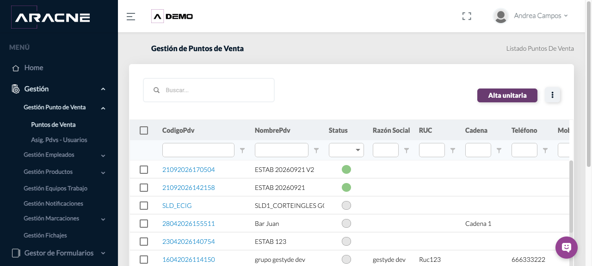
2. Selecciona el código para abrir las cuatro pestañas de la ficha.
   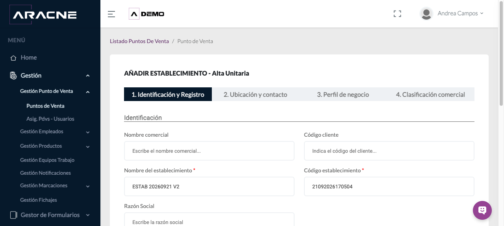

### Alta unitaria
1. Pulsa Alta unitaria.
   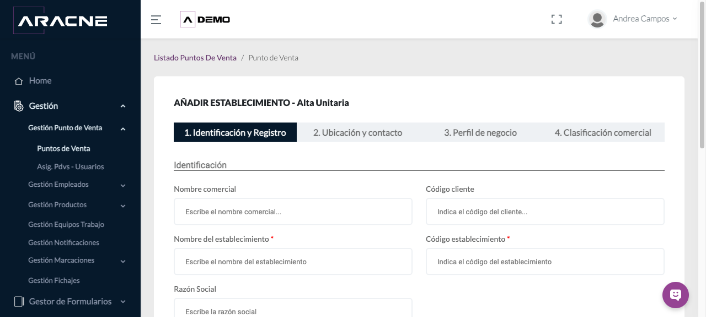
2. Completa Identificación y Registro.
   
3. Completa Ubicación y contacto.
   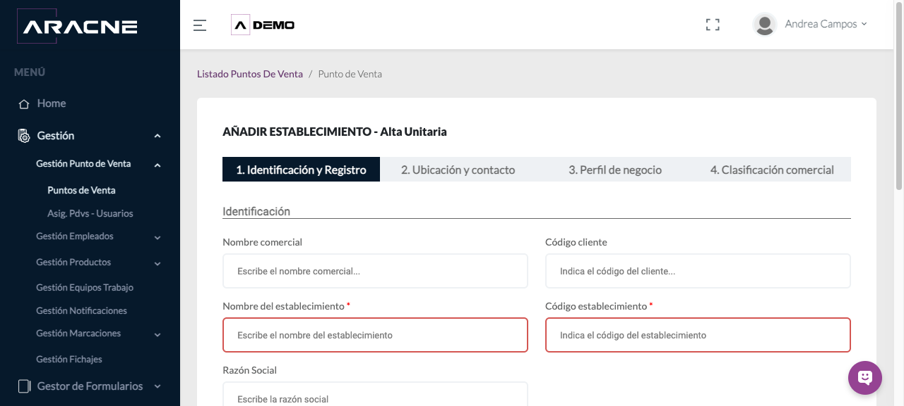
4. Completa Perfil de negocio y Clasificación comercial.
   
   
5. Si corresponde, añade objetivos con tipo, valor, duración y descripción.
   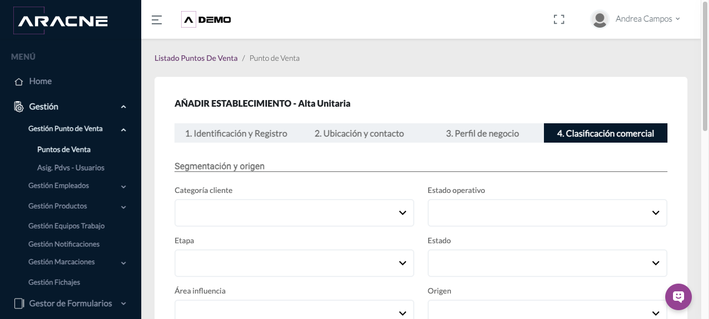
6. Revisa y pulsa Continuar; después localiza el PDV por código o nombre.
   

### Alta masiva de establecimientos
Plantilla: [CargaPuntosDeVenta.xlsx](downloads/CargaPuntosDeVenta.xlsx).

1. En el menú, selecciona Alta masiva establecimientos.
   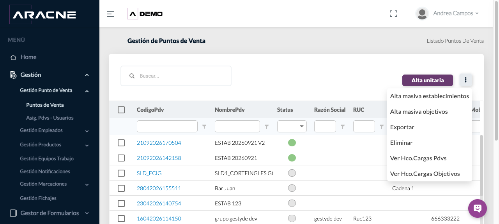
2. Descarga la plantilla oficial.
   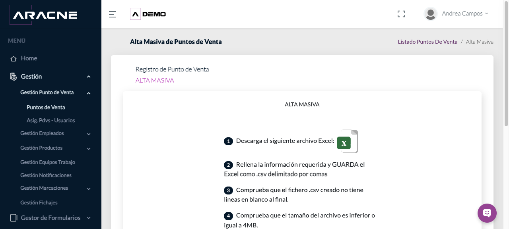
3. Respeta sus 47 cabeceras, desde nombreComercial hasta productoInteresado4.
   
4. Guarda como CSV delimitado por comas, sin líneas vacías al final y de hasta 4 MB.
   
5. Pulsa Subir Archivo.
   
6. Abre Ver Hco.Cargas Pdvs y revisa el resultado y los recuentos.
   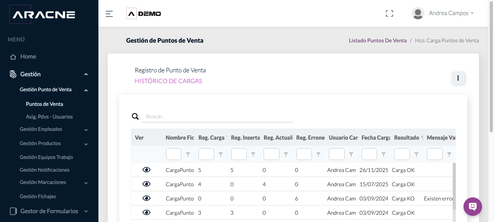
7. En una carga KO, abre Ver y corrige los mensajes indicados.
   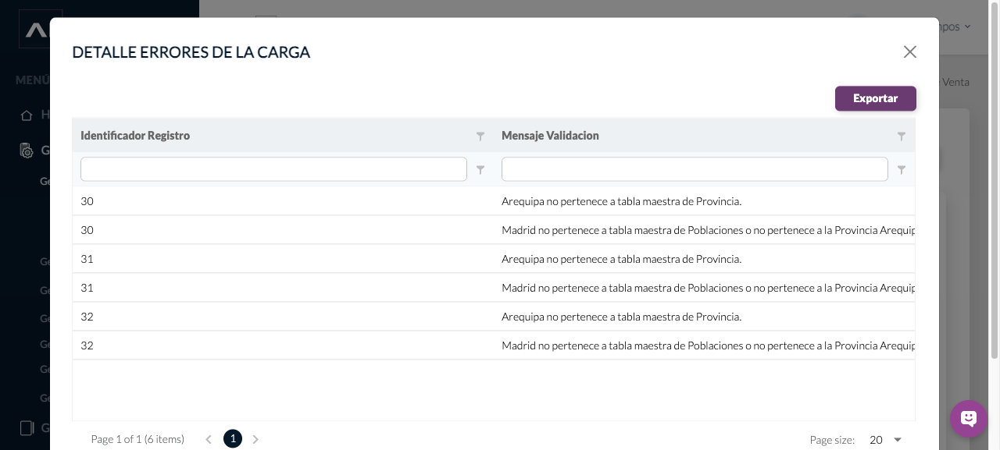

### Alta masiva de objetivos
Plantilla: [CargaObjetivosPdv.xlsx](downloads/CargaObjetivosPdv.xlsx).

1. En el menú, selecciona Alta masiva objetivos.
   
2. Descarga la plantilla con codigoPdv, tipoObjetivo, valorObjetivo, duracionObjetivo y descripcionObjetivo.
   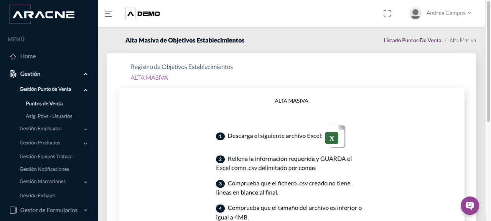
3. Usa códigos existentes y valores admitidos de tipo y duración.
   
4. Guarda como CSV, respeta el límite de 4 MB y pulsa Subir Archivo.
   
5. Abre Ver Hco.Cargas Objetivos.
   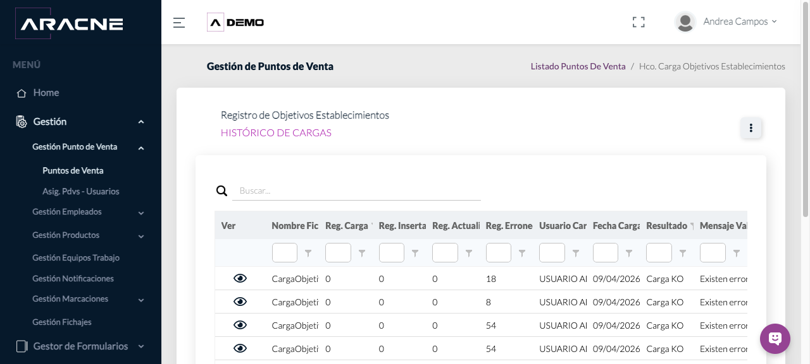
6. En una carga KO, abre Ver y corrige códigos, tipos o duraciones indicados.
   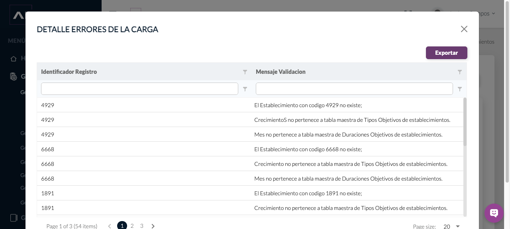

### Menú de acciones
1. Abre el menú: Alta masiva establecimientos, Alta masiva objetivos, Exportar, Eliminar, Ver Hco.Cargas Pdvs y Ver Hco.Cargas Objetivos.
   
2. Exportar descarga un Excel con nombre basado en ListadoPuntosDeVenta y la fecha y hora.
   
3. Para retirar establecimientos, selecciona las filas, pulsa Eliminar y revisa la confirmación.
   
4. Ver Hco.Cargas Pdvs abre las importaciones de establecimientos.
   
5. Ver Hco.Cargas Objetivos abre las importaciones de objetivos.
   

### Resultado esperado
El establecimiento queda disponible para asignación; los objetivos quedan asociados al código del PDV.

**Cómo comprobarlo:** Filtra por código o nombre. Para cargas, revisa el histórico correspondiente y abre cualquier resultado KO.

### Problemas habituales
- Si no aparece Continuar, completa los campos con asterisco.
- Si el archivo no se admite, comprueba formato CSV, líneas finales y límite de 4 MB.
- Si falla una ubicación, utiliza provincia y población existentes y relacionadas.
- Si falla un objetivo, comprueba código de PDV, tipo y duración.

**Operaciones relacionadas:** Asignación PDV–usuarios, Planificador de rutas, Formularios Avanzados

**Vídeos de Puntos de Venta:** [Abrir la sección correspondiente de la videoteca](pages/videos-formativos.html#backoffice).

## 2. Asignación PDV–usuarios

Relacionar uno o varios usuarios con los establecimientos en los que deben trabajar, individualmente o mediante una carga masiva.

**Requisitos:** El empleado y el PDV deben existir. Para cargas masivas, CSV delimitado por comas, sin líneas vacías al final y de hasta 4 MB.  
**Dónde está:** Gestión › Gestión Punto de Venta › Asig. Pdvs - Usuarios

### Consultar asignaciones
1. Utiliza los filtros por empleado, usuario, rol, código o nombre del PDV, usuario de creación o fecha.
   

### Crear una asignación
1. Pulsa Crear asignación.
   
2. Selecciona el usuario.
   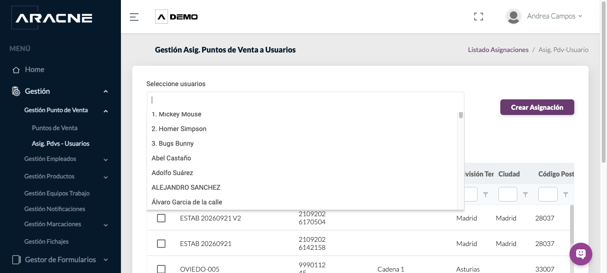
3. Busca los establecimientos con el buscador o los filtros disponibles.
   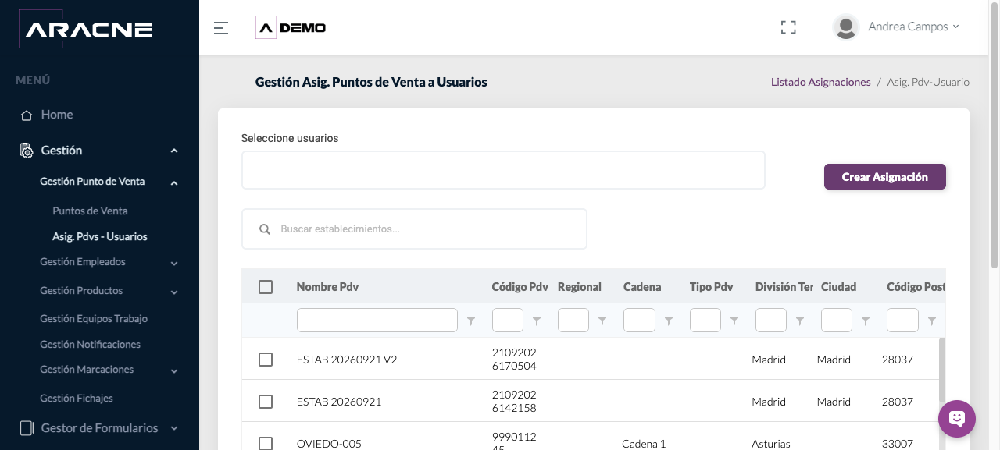
4. Marca las casillas de los establecimientos que correspondan.
   
5. Revisa y pulsa Crear Asignación.
   
6. Filtra el listado por usuario o código para comprobar las nuevas relaciones.
   

### Alta masiva
Plantilla: [CargaPuntosDeVentaUsuarios.xlsx](downloads/CargaPuntosDeVentaUsuarios.xlsx).

1. En el menú, selecciona Alta masiva.
   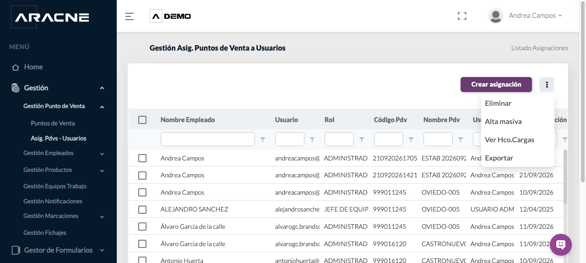
2. Descarga la plantilla oficial.
   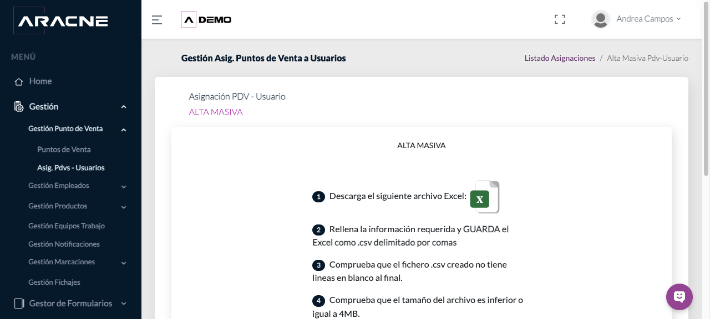
3. Completa codigoPdv y usuario con valores existentes.
   
4. Guarda como CSV delimitado por comas, sin líneas vacías al final y de hasta 4 MB.
   
5. Pulsa Subir Archivo.
   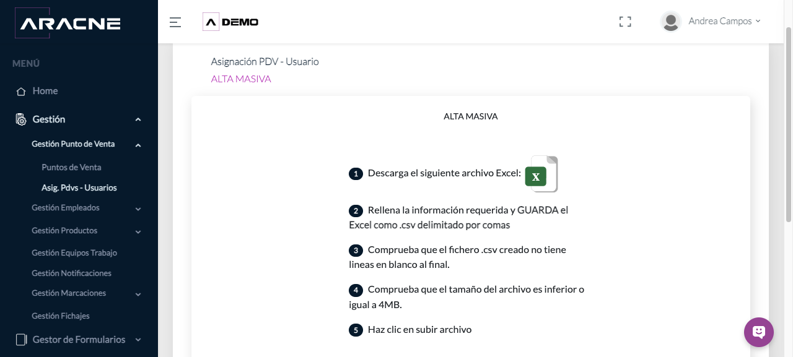
6. Abre Ver Hco.Cargas y comprueba los recuentos y el resultado.
   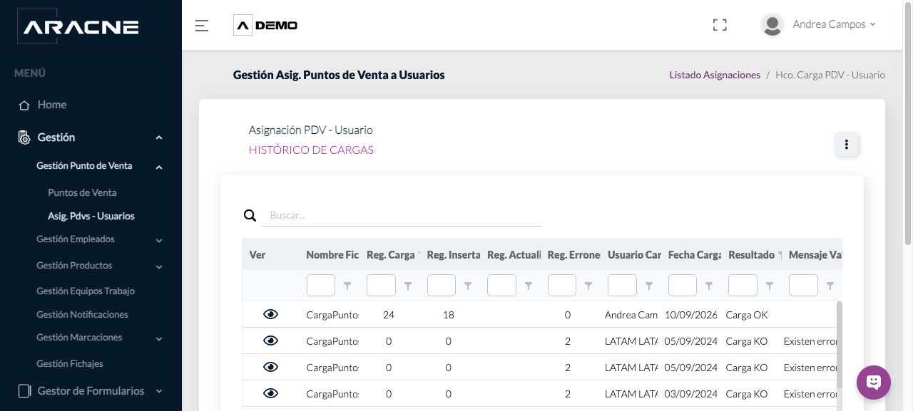
7. En una Carga KO, abre Ver y corrige los mensajes antes de repetirla.
   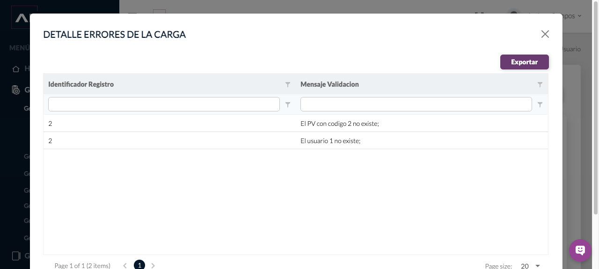

### Menú de acciones
1. Abre el menú: Eliminar, Alta masiva, Ver Hco.Cargas y Exportar.
   
2. Exportar descarga un Excel cuyo nombre comienza por ListadoAsignacionesPuntosDeVentaUsuarios.
   
3. Comprueba sus siete columnas de empleado, usuario, rol, PDV y creación.
   
4. Para retirar relaciones, selecciona filas y pulsa Eliminar.
   
5. Revisa el número en CONFIRMAR ELIMINACIÓN y confirma o cancela.
   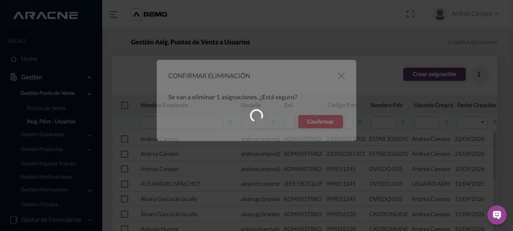

### Histórico y exportaciones
1. Abre Ver Hco.Cargas.
   
2. Revisa fichero, recuentos, usuario, fecha, resultado y mensaje.
   
3. Exportar descarga HcoCargaPuntosDeVentaUsuarios.xlsx.
   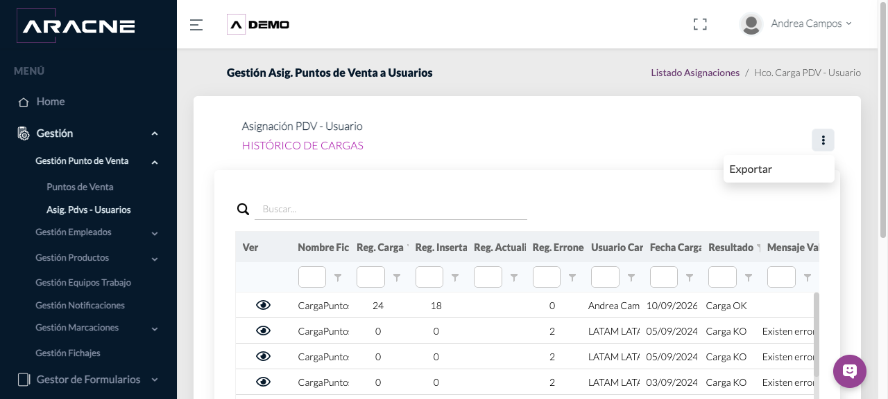
4. En el detalle de una Carga KO, Exportar descarga HcoDetalleCargaAsignacionPdvUsuario.xlsx.
   

### Resultado esperado
Cada relación válida aparece como una fila del listado. En cargas masivas, el histórico muestra los recuentos y el resultado.

**Cómo comprobarlo:** Filtra por usuario o código de PDV. Para cargas, revisa Carga OK o abre el detalle de cualquier Carga KO.

### Problemas habituales
- Si el empleado o el PDV no aparece, comprueba que exista en la campaña.
- Si aparece «Es necesario seleccionar al menos una asignación», marca una o varias filas antes de eliminar.
- Si el detalle indica que el PV o el usuario no existe, corrige codigoPdv o usuario en el CSV.
- Si el archivo no se admite, comprueba formato CSV, líneas vacías finales y límite de 4 MB.

**Operaciones relacionadas:** Empleados, Puntos de Venta, Planificador de rutas

**Vídeos de asignación:** [Abrir la sección correspondiente de la videoteca](pages/videos-formativos.html#backoffice).

## 3. Empleados y ausencias

Dar de alta y mantener empleados, administrar sus cuentas, objetivos y documentos, y registrar ausencias individuales o masivas.

**Requisitos:** Permiso de gestión de empleados. Para cargas masivas, usar la plantilla oficial, guardar como CSV delimitado por comas, eliminar líneas en blanco al final y respetar el límite de 4 MB.  
**Dónde está:** Gestión › Gestión Empleados › Empleados o Absentismos

### Consultar y editar empleados
1. Abre Empleados y utiliza los filtros para localizar el perfil.
   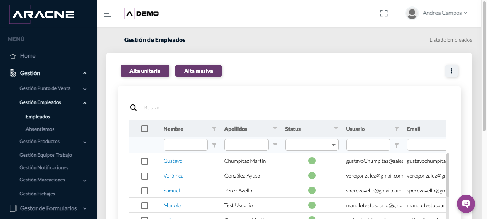
2. Selecciona el nombre del empleado para abrir su ficha.
   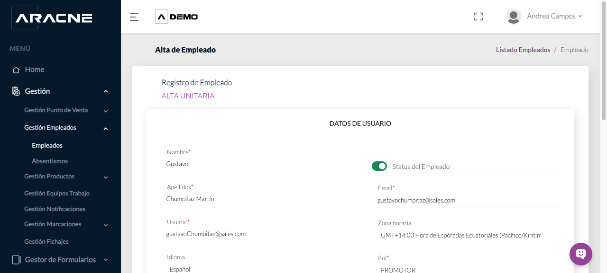
3. Utiliza Datos de usuario, Datos de empleado, Documentación adjunta y Gestión de Cuentas según la información que necesites mantener.
   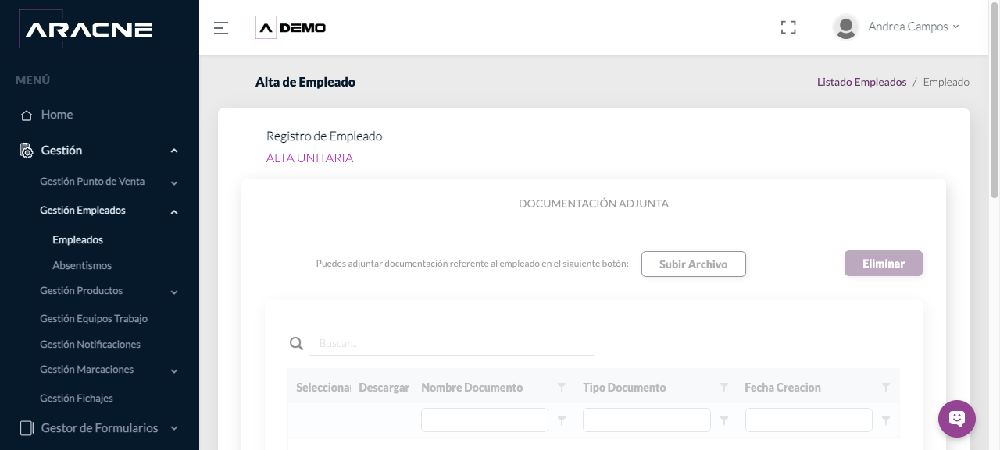

### Alta unitaria
1. Pulsa Alta unitaria en el listado.
   
2. Completa nombre, apellidos, usuario, contraseña, idioma, categoría, estado, correo, zona horaria, rol y superior.
   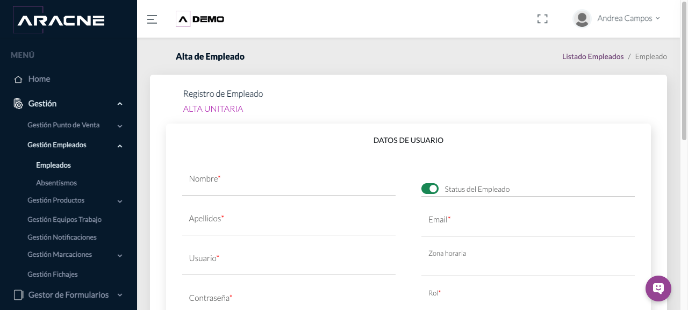
3. Completa los Datos de empleado.
   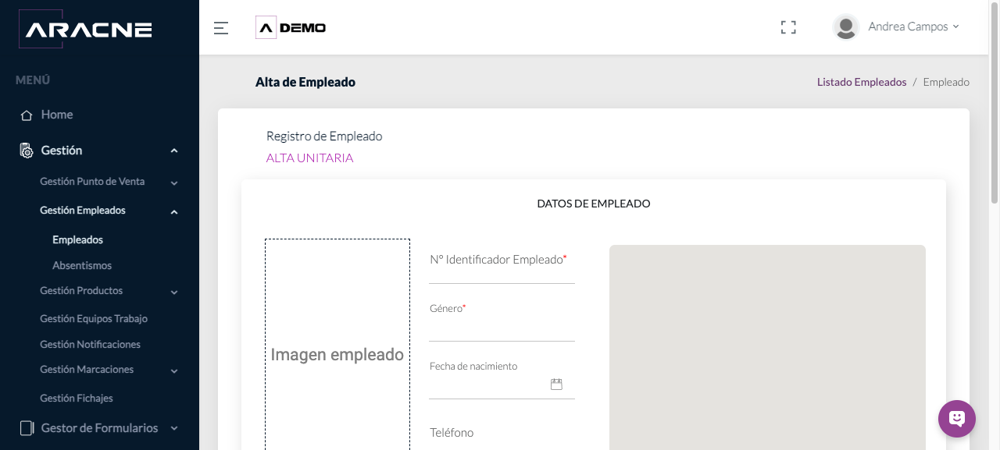
4. Si corresponde, pulsa Añadir objetivo y completa tipo, valor, duración y descripción.
   
5. Revisa Gestión de Cuentas antes de finalizar.
   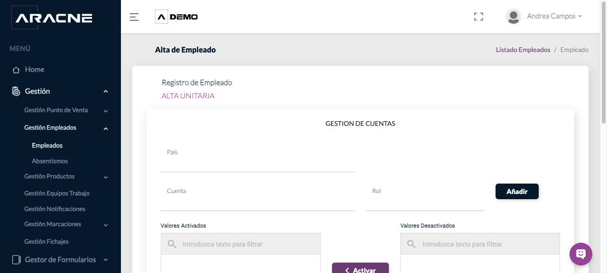

### Alta masiva de empleados
Plantilla oficial: [Descargar CargaDeEmpleados.xlsx](downloads/CargaDeEmpleados.xlsx).

1. Pulsa Alta masiva.
   
2. Descarga la plantilla. Contiene las columnas nombre, apellidos, usuario, email, rol, superior, zonaHoraria, idioma, categoria, documentoIdentificador, genero, fechaNacimiento, telefono, provincia, poblacion, direccion, ciudad, codigoPostal, latitud y longitud.
   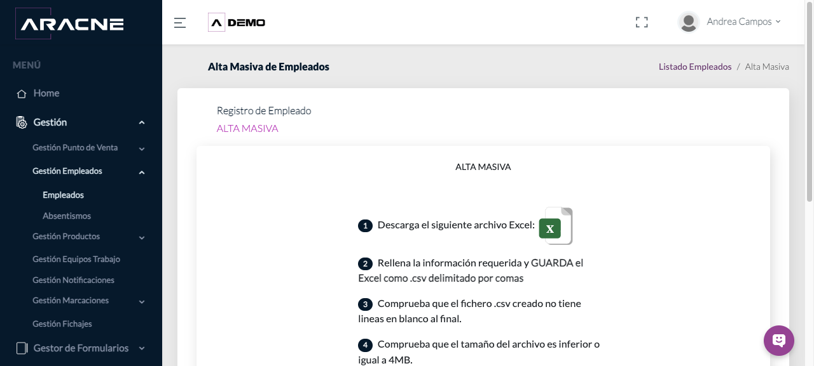
3. Rellena el archivo y guárdalo como CSV delimitado por comas; elimina líneas vacías al final y comprueba que no supera 4 MB.
   
4. Pulsa Subir Archivo y selecciona el CSV.
   
5. Abre Ver Hco.Cargas y revisa los recuentos y el resultado.
   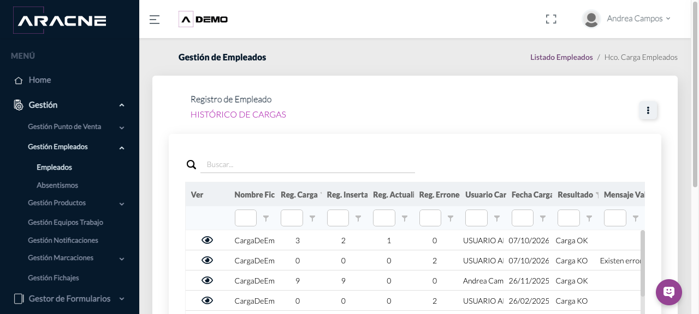
6. En una carga con errores, pulsa el ojo de la columna Ver y revisa o exporta el detalle.
   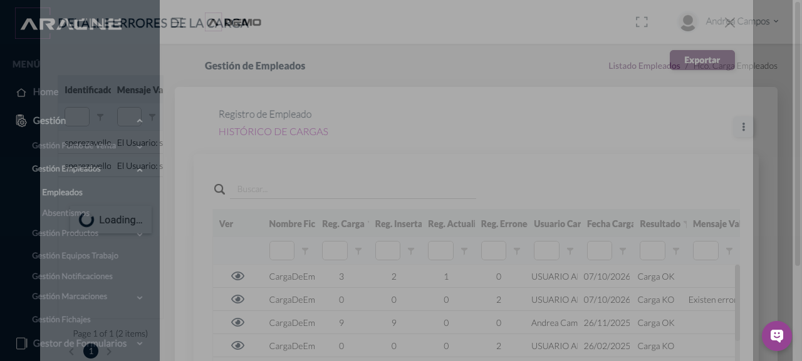

### Menú de acciones de Empleados
1. Abre el menú de acciones: Exportar, Inhabilitar, Habilitar, Resetear Password y Ver Hco.Cargas.
   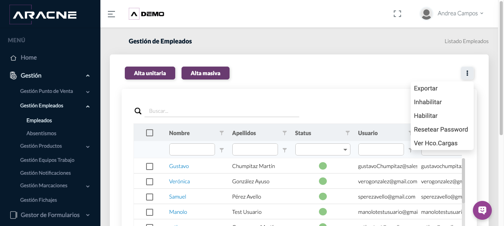
2. Para descargar el listado, pulsa Exportar. El archivo generado se llama ListadoEmpleados.xls.
   
3. Para cambiar la disponibilidad, selecciona las filas y usa Inhabilitar o Habilitar; después comprueba Status.
   
4. Para iniciar el restablecimiento de acceso, selecciona los perfiles y pulsa Resetear Password; revisa la confirmación antes de continuar.
   
5. Para revisar importaciones, abre Ver Hco.Cargas.
   

### Documentos del empleado
1. Abre un empleado, entra en Documentación adjunta y utiliza Subir Archivo. La tabla permite consultar y descargar los documentos existentes.
   

### Absentismos
Plantilla oficial: [Descargar CargaAbsentismos.xlsx](downloads/CargaAbsentismos.xlsx).

1. Consulta empleado, tipo, fechas, sustitución, observaciones, documento y datos de creación. Cuando Documento indique SI, utiliza Descargar.
   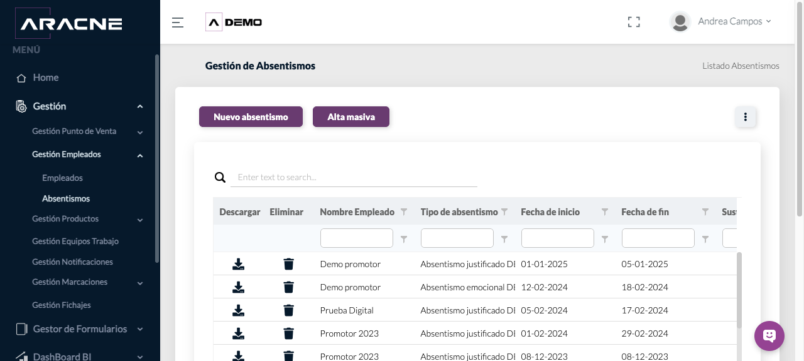
2. Pulsa Nuevo absentismo y completa empleado, tipo, fechas, sustituto, observaciones y adjunto cuando corresponda.
   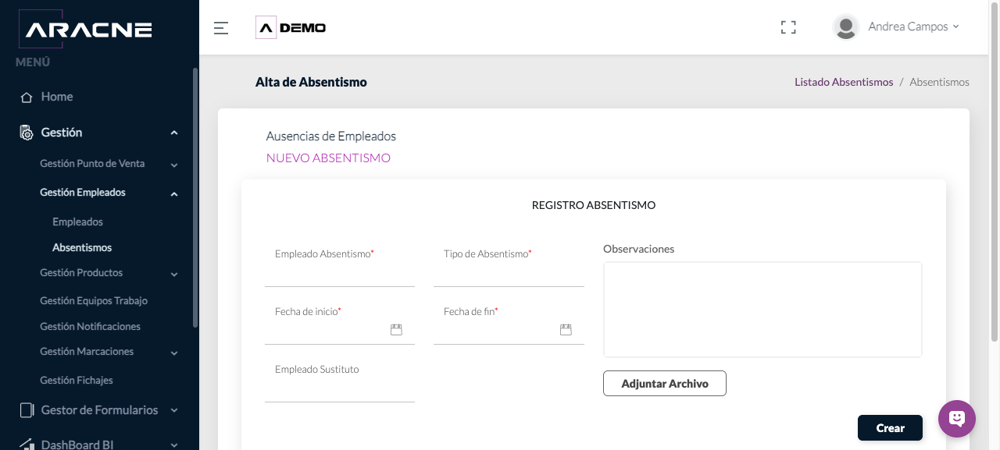
3. Para una carga masiva, pulsa Alta masiva, prepara el CSV con la plantilla y pulsa Subir Archivo.
   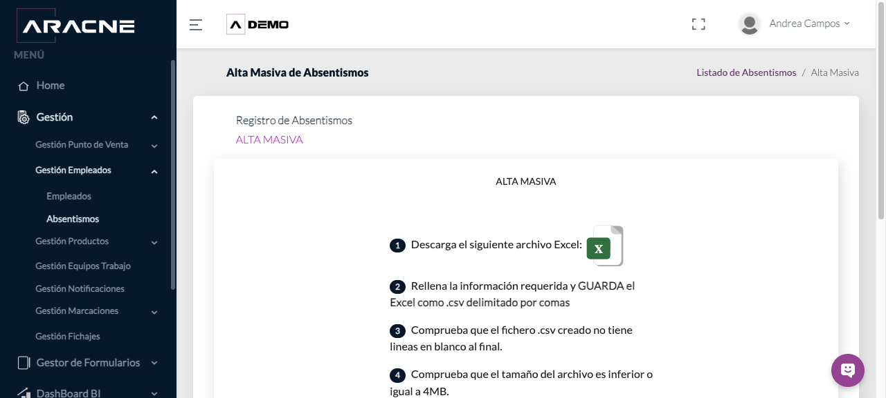
4. Abre el menú: Exportar descarga Informe de Absentismos.xls y Ver Hco.Cargas abre las importaciones.
   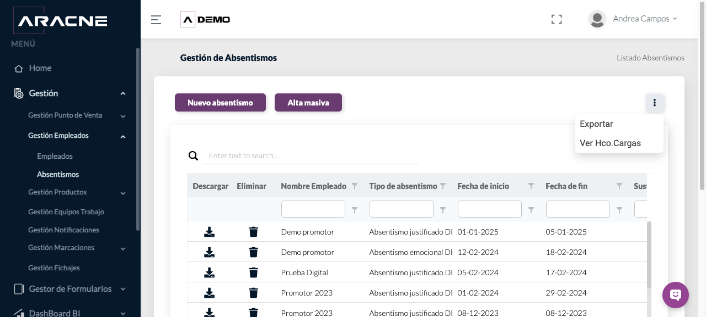
5. Revisa el histórico y sus recuentos; cuando no existen cargas, la tabla muestra “No data to display”.
   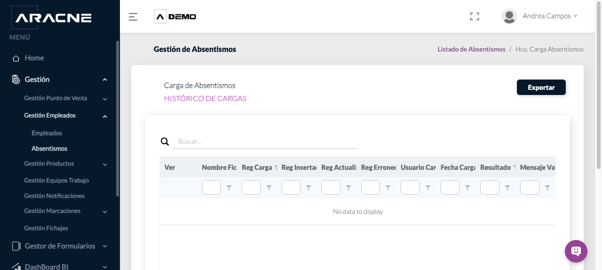
6. Para retirar una ausencia, utiliza Eliminar en su fila y revisa la confirmación antes de continuar.
   

### Resultado esperado
El empleado queda localizable con estado, rol, superior, cuentas y datos necesarios; las ausencias quedan registradas. Las cargas masivas muestran su resultado en el histórico.

**Cómo comprobarlo:** Busca el empleado o la ausencia. Para importaciones, revisa el resultado, los recuentos y el detalle de errores.

### Problemas habituales
- Si el archivo no se admite, comprueba formato CSV delimitado por comas, ausencia de líneas vacías al final y límite de 4 MB.
- Si una carga contiene errores, abre el detalle, corrige los registros identificados y repite la carga.
- Si un empleado no aparece en un selector, comprueba estado, rol y cuenta asignada.
- Si las fechas no coinciden, revisa zona horaria e intervalo.

**Operaciones relacionadas:** Equipos de trabajo, Gestión de Fichajes, Asignación PDV–usuarios

**Vídeos de Empleados:** [Abrir la sección correspondiente de la videoteca](pages/videos-formativos.html#backoffice).

## 4. Catálogo de productos

Crear y mantener SuperCategorías, Categorías, Marcas, Líneas de Producto y Productos.

**Requisitos:** Define la jerarquía en ese orden.  
**Dónde está:** Gestión › Gestión Productos  
**Importante:** La acción de interfaz **Eliminar** desactiva el registro del catálogo; no lo borra físicamente.

### Consultar la jerarquía
1. Revisa SuperCategorías.  
   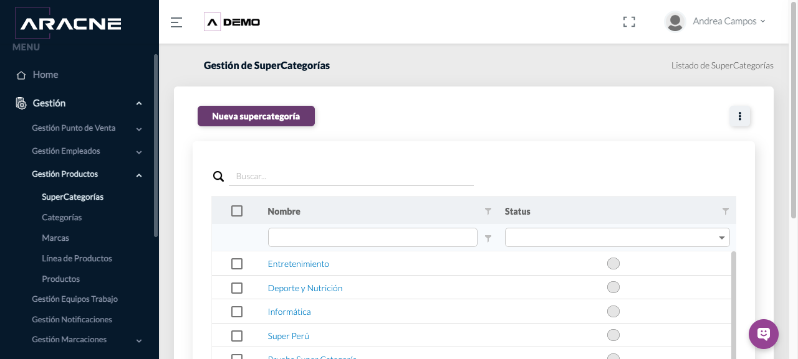
2. Revisa Categorías y su SuperCategoría.  
   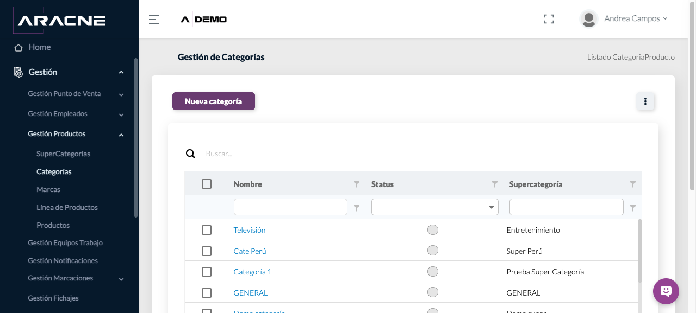
3. Revisa Marcas.  
   
4. Revisa Líneas, jerarquía, Marca y Origen.  
   
5. Revisa Productos, códigos, jerarquía, PVP y etiquetas.  
   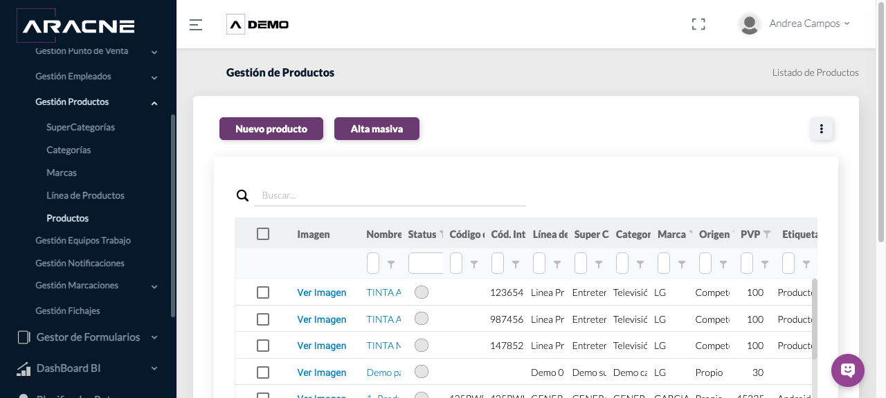

### SuperCategorías, Categorías y Marcas
1. Utiliza Nueva supercategoría, Nueva categoría o Nueva marca.  
   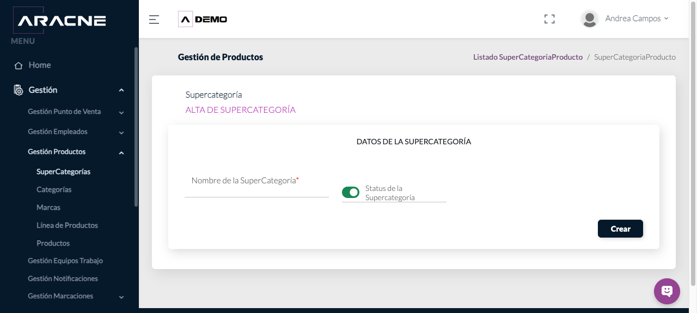
2. En Categorías, selecciona también la SuperCategoría.  
   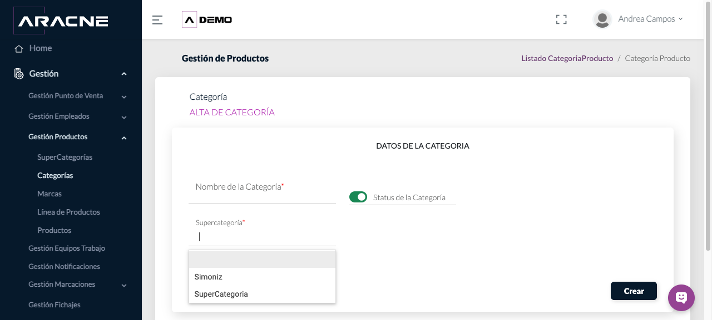
3. Los menús de estos tres niveles contienen Exportar y Eliminar.  
   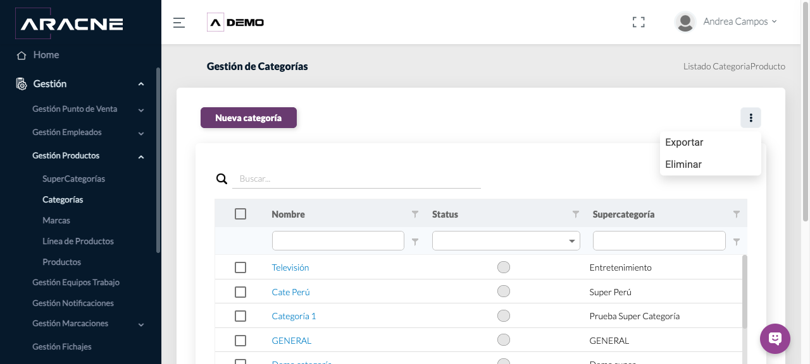
4. Exportar genera el informe XLS correspondiente; Eliminar desactiva las filas seleccionadas.  
   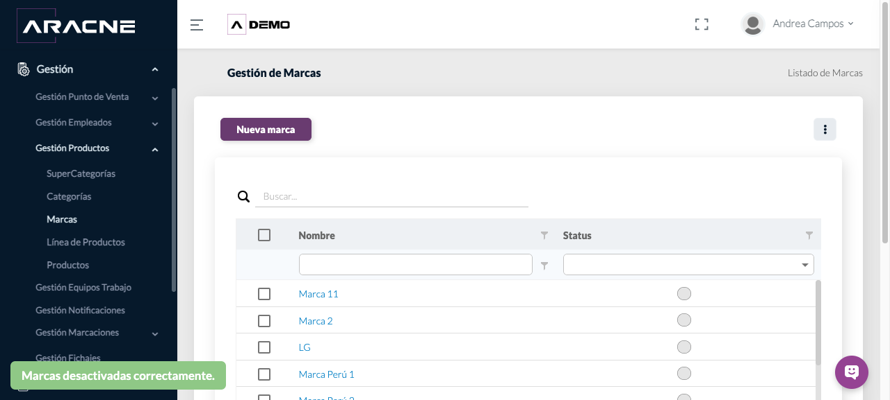

### Líneas de Producto
1. En Nueva linea producto, completa nombre, estado, Marca, Super Categoría, Categoría y Origen.  
   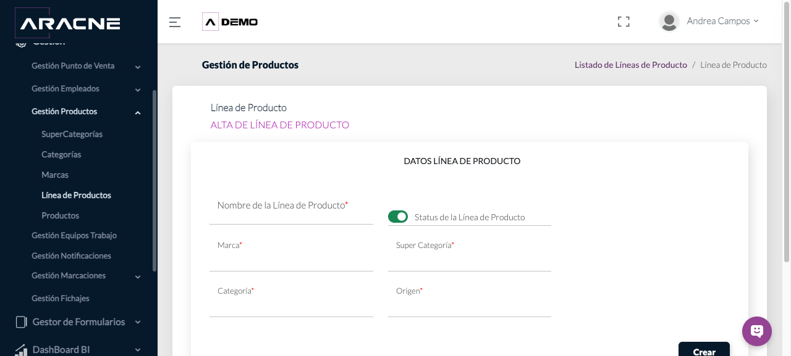
2. En Alta masiva, descarga [CargaLineaProductos.xlsx](downloads/CargaLineaProductos.xlsx).  
   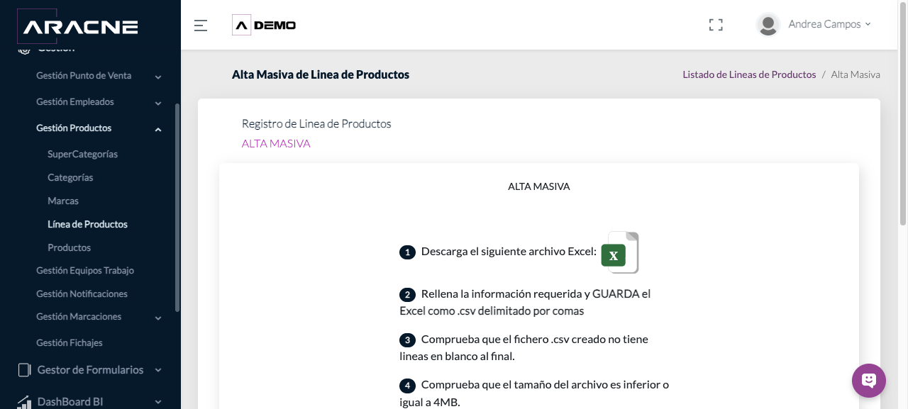
3. Completa nombreLineaProducto, superCategoria, categoria, marca y origen; guarda un CSV delimitado por comas, sin líneas vacías finales y de hasta 4 MB.
4. Abre Ver Hco.Cargas y revisa los recuentos, resultado y mensaje.  
   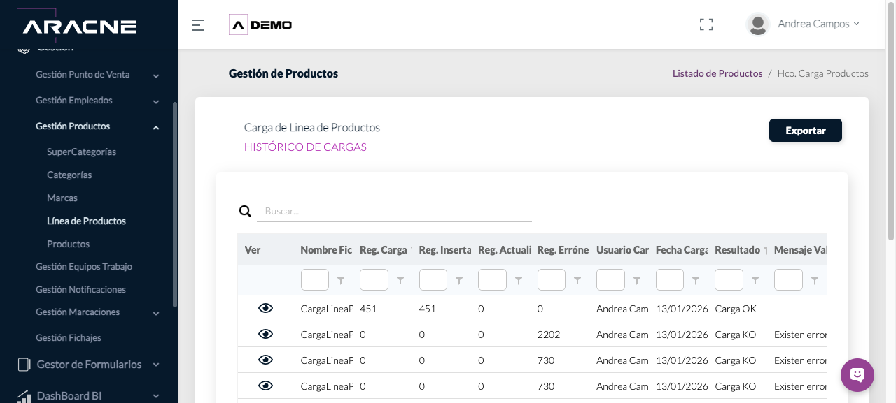
5. En una Carga KO, abre Ver y corrige los errores antes de repetirla.  
   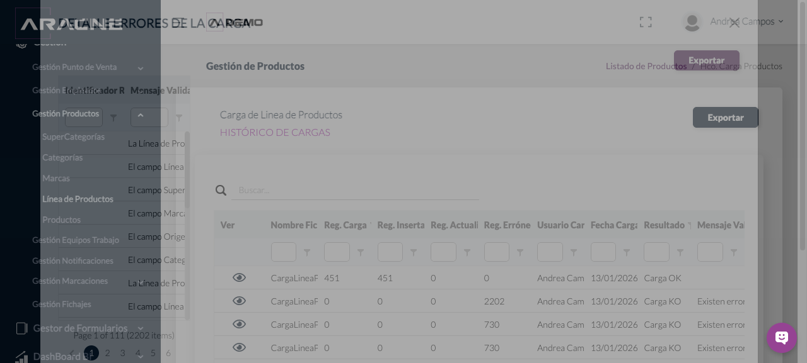
6. Exportar descarga Informe de Lineas.xls; Eliminar desactiva las líneas seleccionadas.  
   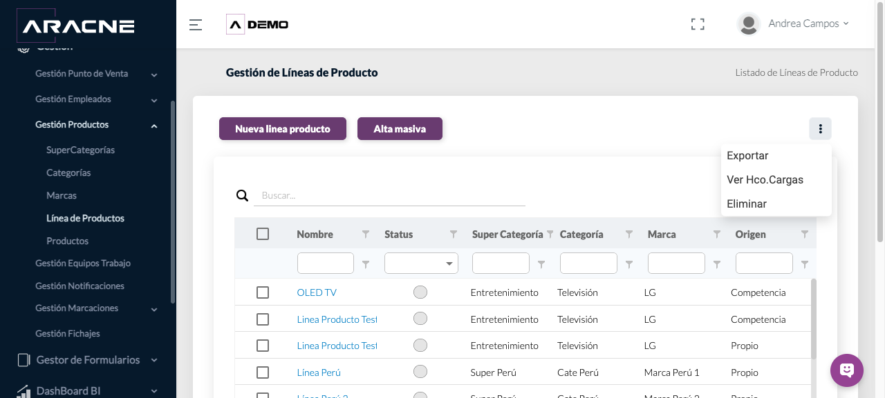

### Productos
1. En Nuevo producto, completa imagen, nombre, estado, códigos, Línea, PVP y etiquetas.  
   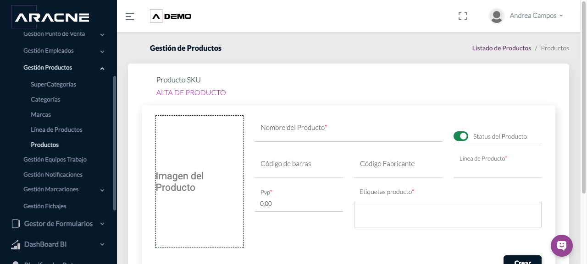
2. En Alta masiva, descarga [CargaProductos.xlsx](downloads/CargaProductos.xlsx).  
   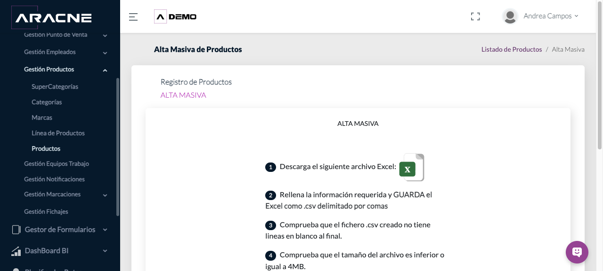
3. Completa nombreProducto, codigoBarras, codigoFabricante, lineaProducto, pvp, etiquetas, superCategoria, categoria, marca y origen; guarda un CSV delimitado por comas, sin líneas vacías finales y de hasta 4 MB.
4. Abre Ver Hco.Cargas y corrige cualquier validación antes de repetir el archivo.  
   
5. Exportar genera el informe XLS y el histórico genera HcoCargaProductos.xlsx; Eliminar desactiva los Productos seleccionados.  
   

### Resultado esperado
La jerarquía queda disponible y las Líneas y Productos conservan sus relaciones.

**Cómo comprobarlo:** Busca por nombre, revisa estado y relaciones y, para cargas masivas, confirma Carga OK y los recuentos.

### Problemas habituales
- Si un nivel padre no aparece, comprueba que exista y esté activo.
- Si una Línea no existe, corrige lineaProducto o créala antes de cargar Productos.
- Si un Producto está repetido, elimina la duplicidad del CSV.
- Si el archivo no se admite, comprueba formato CSV, líneas vacías finales y límite de 4 MB.
- Eliminar en este catálogo significa desactivar, no borrar físicamente.

**Operaciones relacionadas:** Formularios Avanzados, Panel de Control

## 5. Equipos de trabajo

Agrupar comerciales bajo un supervisor y mantener la composición de cada equipo.

**Requisitos:** Supervisor y comerciales disponibles en la campaña.  
**Dónde está:** Gestión › Gestión Equipos Trabajo  
**Importante:** Eliminar retira inmediatamente el equipo seleccionado y no muestra una confirmación adicional.

### Consultar equipos
1. Utiliza el buscador o los filtros de Nombre, Supervisor, Status, Nº Comerciales, Usuario Creación y Fecha Creación.  
   

### Crear un equipo
1. Pulsa Nuevo equipo de trabajo.  
   
2. Introduce el nombre.  
   
3. Selecciona uno o varios comerciales.  
   
4. Selecciona el supervisor.  
   
5. Pulsa Guardar y comprueba el equipo en el listado.

### Editar un equipo
1. Pulsa el nombre del equipo en el listado.
2. Modifica nombre, comerciales o supervisor y pulsa Actualizar.  
   
3. Comprueba el supervisor y el Nº Comerciales en el listado.

### Menú de acciones
1. Abre el menú de tres puntos: Exportar y Eliminar.  
   
2. Exportar descarga ListadoEquiposTrabajo.xls.
3. Para eliminar, marca una fila. Sin selección aparece «Es necesario seleccionar al menos un equipo de trabajo».  
   
4. Eliminar retira el equipo inmediatamente y muestra el mensaje de resultado; no aparece una confirmación adicional.  
   

### Resultado esperado
El equipo aparece con su supervisor y el número de comerciales seleccionados.

**Cómo comprobarlo:** Busca el nombre, contrasta Supervisor y Nº Comerciales y abre la ficha para revisar los integrantes.

### Problemas habituales
- Si falta un comercial o supervisor, comprueba que su usuario esté disponible en la campaña.
- Si el Nº Comerciales no coincide, revisa las etiquetas de la ficha.
- Si aparece el aviso de selección, marca una fila antes de usar Eliminar.
- Utiliza Eliminar con precaución porque se ejecuta sin confirmación adicional.

**Operaciones relacionadas:** Empleados y ausencias, Planificador de rutas

## 6. Notificaciones

Preparar y enviar comunicaciones a la aplicación móvil por rol o por usuario.

**Requisitos:** Roles y usuarios disponibles en la campaña.  
**Dónde está:** Gestión › Gestión Notificaciones  
**Estado de ESPAÑA - DEMO:** El listado está vacío; Eliminar aparece deshabilitado.

### Consultar notificaciones
1. Utiliza el buscador o los filtros de título, mensaje, Tipo Notificación, usuario, rol, Adjunto y Fecha Creación.  
   

### Crear una notificación
1. Pulsa Nueva notificación.  
   
2. Elige Rol o Usuario.  
   
3. Por Rol, selecciona el rol destinatario.  
   
4. Por Usuario, selecciona uno o varios usuarios.  
   
5. Introduce Asunto y Mensaje, ambos obligatorios.  
   
6. Adjunta un archivo si corresponde.
7. Revisa y pulsa Enviar únicamente cuando quieras remitirla a la app móvil.

### Menú de acciones
1. El menú contiene Exportar y Eliminar.  
   
2. Exportar descarga ListadoNotificaciones.xlsx con título, mensaje, Tipo Notificación, usuario, rol, Adjunto y Fecha Creación.
3. Eliminar está deshabilitado mientras no haya registros.

### Resultado esperado
La notificación queda dirigida al rol o a los usuarios elegidos para su recepción en la aplicación móvil.

**Cómo comprobarlo:** Localízala en el listado por asunto, usuario, rol o fecha cuando existan registros.

### Problemas habituales
- Si no aparece un usuario o rol, comprueba que exista en la campaña.
- Si no puedes enviar, revisa los campos obligatorios.
- Si el listado está vacío, Eliminar permanece deshabilitado.

**Operaciones relacionadas:** Empleados y ausencias, Equipos de trabajo, Promotor y app móvil

## 7. Gestión de Fichajes

Configurar horarios, generar jornadas, consultar el tiempo fichado y registrar ausencias.

**Requisitos:** Empleados existentes y activos; para generar jornadas debe existir previamente un horario.  
**Dónde está:** Gestión › Gestión Fichajes

### Relación entre los apartados
Horarios define la franja; Jornadas la aplica a empleados y fechas; Fichajes muestra el tiempo registrado; Ausencias recoge los periodos no trabajados.

### Crear y consultar horarios
1. Consulta el listado de Horarios.  
   
2. Pulsa Nuevo Horario.  
   
3. Introduce el nombre y elige Completa, Partida o Extra.  
   
4. Selecciona los días laborables y ajusta sus tramos. Activa Descanso si existe una pausa.  
   
5. Revisa y pulsa Guardar. Comprueba que el horario aparezca en el listado.

### Crear, consultar y exportar jornadas
1. Abre Jornadas y selecciona Fecha desde y Fecha hasta.  
   
2. Pulsa Nueva Jornada y completa Horario, Fecha Inicio, Fecha Fin y Usuarios.  
   
3. Abre el detalle para consultar horas, descanso, tiempo imputado y validación.  
   
4. El menú contiene Exportar, Carga Masiva y Ver Hco. Cargas.  
   
5. Exportar descarga el listado del periodo en Excel.

### Cargar jornadas de forma masiva
1. Selecciona Carga Masiva.
2. Descarga [CargaAsistenciaLaboral.xlsx](downloads/CargaAsistenciaLaboral.xlsx), con usuario, fechaInicio, fechaFin y horario.  
   
3. Completa la plantilla y guárdala como CSV delimitado por comas, sin líneas vacías finales y con un máximo de 4 MB.  
   
4. Sube el CSV y consulta Ver Hco. Cargas.
5. Revisa registros cargados, insertados, actualizados y erróneos, resultado y mensaje; el histórico también puede exportarse.  
   

### Consultar fichajes
1. Abre Fichajes y selecciona una fecha.  
   
2. Revisa el tiempo imputado frente al planificado y su distribución en la escala horaria.  
   

### Crear, consultar y exportar ausencias
1. Abre Ausencias y filtra por empleado.  
   
2. Pulsa Nueva Ausencia.  
   
3. Selecciona empleado y tipo; en ESPAÑA - DEMO está disponible Vacaciones.  
   
4. Introduce fechas, sustituto y observaciones cuando corresponda; revisa y guarda.
5. Usa Exportar para descargar el listado en Excel.  
   

### Resultado esperado
Los horarios permiten generar jornadas; las jornadas se consultan por periodo; Fichajes muestra el tiempo registrado y Ausencias refleja los periodos no trabajados.

**Cómo comprobarlo:** Localiza la jornada del empleado y fecha, revisa su detalle, consulta Fichajes en ese día y comprueba si existe una ausencia.

### Problemas habituales
- Si un empleado no aparece, comprueba que exista y esté activo.
- Si no puedes crear una jornada, comprueba el horario y las fechas.
- Si Fichajes está vacío, consulta una fecha incluida en las jornadas del empleado.
- Si una carga falla, revisa columnas, formato CSV, líneas vacías y límite de 4 MB; consulta el histórico.

**Operaciones relacionadas:** Empleados y ausencias, Promotor y app móvil, Planificador de rutas

## 8. Formularios Avanzados

Configurar formularios complejos, organizarlos en secciones, definir campos y dependencias, y asignarlos a establecimientos.

**Requisitos:** Roles, establecimientos y catálogos necesarios creados.  
**Dónde está:** Gestor de Formularios › Formularios Avanzados

### Procedimiento
1. Abre Nuevo formulario avanzado. En Configuración indica Nombre, Roles que verán el formulario, dónde se rellena, número de respuestas, obligatoriedad y estado.
   
   
2. Define si se registrarán horas y coordenadas, si habrá alertas y, cuando proceda, los destinatarios.
   
3. Continúa a Estructura y control. Añade secciones con un nombre claro y ordénalas según el trabajo de campo.
   
4. Añade campos dentro de cada sección. Indica Nombre del campo, Tipo de campo y descripción; activa solo las opciones necesarias.
   
5. Configura validación por longitud, rango numérico, escala u opciones cuando el tipo de campo lo permita. Marca Campo obligatorio cuando deba impedirse una respuesta incompleta.
   
6. Crea dependencias seleccionando Origen, Valores del campo de origen, Habilitar y Campo/Sección que habilita.
   
7. Revisa Diseño para confirmar orden, agrupación y comprensión.
   
8. Asigna el formulario a los establecimientos correspondientes desde la opción de asignación del formulario.
   
9. Activa el formulario y comprueba su disponibilidad con un usuario del rol asignado.
   
### Diseñar secciones, campos y dependencias
1. Completa Configuración y Estructura y control; después abre 3. Diseño.  
   
2. En Diseño puedes buscar, previsualizar y utilizar Añadir.  
   
3. Añadir ofrece Sección, Campo y Dependencias.  
   
4. Para crear una sección, escribe su nombre, configura su relación cuando corresponda y pulsa Añadir sección.  
   
5. Para crear un campo, introduce nombre, tipo, descripción, propiedades y sección de destino.  
   
6. Los tipos disponibles son Archivo, Buscador, Calificación, Check, Email, Escala Lineal, Fecha, Firma, Imagen, Numérico, Selector único o múltiple, Texto libre, Título, Ubicación y Vídeo.  
     
   
7. Revisa las propiedades y pulsa Añadir campo.
8. Para crear una dependencia, selecciona Origen, Valores del campo de origen, Habilitar y Campo/Sección que habilita.  
   
9. Habilitar admite Campo, Sección y Finalizar Formulario.  
   

### Duplicar o eliminar un formulario
1. En el listado, utiliza el icono de duplicar o el icono de la papelera para Eliminar.
2. Si el formulario no tiene reportes asociados, Eliminar lo borra. Si tiene reportes, lo desactiva para conservar la información vinculada.
3. Comprueba después si desapareció del listado o quedó inactivo.

### Campos y controles
- Roles que verán el formulario: perfiles que reciben el formulario.
- Dónde se rellena: contexto de cumplimentación.
- Número de respuestas por día/establecimiento: frecuencia admitida.
- Campo activo y obligatorio: disponibilidad y exigencia.
- Traer respuestas anteriores: recupera datos previos cuando se configura.
- Origen y valor: condición que dispara la dependencia.
- Habilitar y Campo/Sección que habilita: efecto de la condición.
- Asignación a establecimientos: limita dónde debe aparecer.

### Resultado esperado
El formulario activo aparece para los roles y establecimientos asignados, con secciones, reglas y dependencias previstas.

**Cómo comprobarlo:** Usa un perfil de prueba del rol: abre el establecimiento, entra al formulario, recorre secciones, activa cada dependencia y confirma obligatoriedad y límites.

### Problemas habituales
- Si no aparece, comprueba estado, rol y asignación al establecimiento.
- Si una dependencia no se activa, revisa el campo de origen y el valor exacto.
- Si un campo queda fuera de lugar, revisa su sección y el orden en Diseño.
- Si no permite finalizar, localiza los campos obligatorios sin respuesta.

**Operaciones relacionadas:** Puntos de Venta, Fotos de Formularios Avanzados, Promotor y app móvil

## 9. DashBoard BI, Status y Dashboard

Consultar informes BI, el estado diario de los empleados y los indicadores operativos de la campaña.

**Requisitos:** Permisos de consulta y datos disponibles.  
**Dónde está:** DashBoard BI › Reportes; Informes › Status; Informes › Dashboard

### Consultar un reporte BI
1. Abre DashBoard BI › Reportes.  
   
2. Selecciona B2B Chile, B2B Promotor o Report Usage Metrics Report.  
   
3. Comprueba el reporte elegido y su última actualización.  
   
4. El menú ofrece Imprimir, Restaurar valores y Actualizar.  
   

### Consultar Status
1. Abre Informes › Status.  
   
2. Filtra por PDV, Rol y Supervisor.  
     
     
   
3. Consulta Promotores, Asistencia, Cobertura y Absentismos Injustificados.
4. Revisa Nombre, Rol, Supervisor y Observación en Todos los empleados.
5. Alterna entre Activos, Pendientes y Ausentes.  
     
     
   

### Consultar el Dashboard operativo
1. Abre Informes › Dashboard.  
   
2. Filtra por Rol, Cadena, Canal, Categoría y Regional.  
   
3. Consulta Asistencia del día, Cobertura ruta del día, Absentismo del día y los totales de usuarios y promotores.
4. Revisa los gráficos Dimensionado, Asistencia, Cobertura y Cobertura - Cadena; usa + y − para cambiar su tamaño.  
   

### Resultado esperado
Los informes, indicadores, listados y gráficos se ajustan al reporte o a los filtros seleccionados.

**Cómo comprobarlo:** Revisa el reporte y su última actualización, la fecha de Status y todos los filtros activos.

### Problemas habituales
- Si un indicador queda a cero, revisa filtros y fecha.
- Si un empleado figura Sin jornada, comprueba Gestión de Fichajes.
- Si Status está vacío, vuelve a Todos los empleados y revisa los filtros.
- Si un reporte conserva selecciones anteriores, utiliza Restaurar valores.

**Operaciones relacionadas:** Gestión de Fichajes, Planificador de rutas, Tracking

## 10. Planificador de rutas

Consultar la agenda de cada usuario, cargar rutas programadas y revisar importaciones.

**Requisitos:** Usuarios y PDV existentes; PDV disponibles para el usuario.  
**Dónde está:** Planificador Rutas › Rutas

### Consultar usuarios y contadores
1. Abre Rutas y localiza al usuario mediante Buscar o los filtros.  
   
2. Revisa Número Rutas Programadas y Número Rutas Periódicas.

### Consultar la agenda
1. Pulsa el nombre del empleado.
2. Utiliza Full Week para consultar días y horas.  
   
3. Utiliza Month para consultar el mes.  
   
4. Una ruta muestra horario, nombre, tipo, estado y establecimientos.  
   
5. Pulsa el bloque para desplegar su resumen.  
   

### Cargar rutas programadas
1. Pulsa Alta masiva.
2. Descarga [CargaRutasProgramadas.xlsx](downloads/CargaRutasProgramadas.xlsx).
3. Completa codigoPdv, usuario, nombreRuta, fechaJornada, tipoJornada, horaInicioJornada, horaFinJornada, horaInicioExtra y horaFinExtra.  
   
4. Guarda como CSV delimitado por comas, sin líneas vacías finales y con un máximo de 4 MB.
5. Sube el archivo y consulta el histórico.

### Exportar y revisar cargas
1. El menú contiene Exportar y Ver Hco.Cargas.  
   
2. Exportar descarga ListadoRutasUsuarios.xls.
3. Ver Hco.Cargas muestra los recuentos, usuario, fecha, resultado y mensaje.  
   
4. Pulsa el ojo para consultar y exportar los errores.  
   

### Resultado esperado
El usuario aparece con sus contadores actualizados y la ruta puede consultarse en su agenda.

**Cómo comprobarlo:** Revisa el resultado de la carga y consulta la agenda del usuario en la fecha correspondiente.

### Problemas habituales
- Si una carga falla, revisa usuario, PDV, fecha y horas.
- Si el PDV ya está asignado en la jornada diaria, revisa la ruta existente.
- Si la agenda está vacía, cambia de semana o utiliza Month.
- Si el PDV no está disponible, revisa Asignación PDV–usuarios.

**Operaciones relacionadas:** Puntos de Venta, Asignación PDV–usuarios, Promotor y app móvil

## 11. Informes operativos

Generar listados de campaña, consultar Formularios Avanzados y revisar Tracking.

**Requisitos:** Acceso a Informes y los filtros que pida cada opción.  
**Dónde está:** Informes

### Informes Genéricos
1. Abre Informes Genéricos y selecciona una opción.  
   
2. Completa los filtros visibles. Los informes disponibles y sus filtros son:
   - Informe Absentismos: fechas y usuario.
   - Informe de rol/número de usuarios: sin filtros adicionales.
   - Informe Empleados: sin filtros adicionales.
   - Informe estados establecimientos: fechas.
   - Informe etapas establecimientos: fechas.
   - Informe Formularios - Formularios Avanzados: fechas, opciones, formulario y usuario.
   - Informe kilometraje rutas: fechas y usuario.
   - Informe Productos: sin filtros adicionales.
   - Informe Puntos de Venta: sin filtros adicionales.
   - Informe Rutas: fechas y usuario.
   - Informe Tracking: fechas y usuario.
   - Informe Trayectos: fechas y usuario.
3. Pulsa Generar informe y revisa la tabla.  
   
4. Pulsa Exportar cuando aparezca sobre el resultado.

### Formularios Avanzados
1. Selecciona Informe Formularios - Formularios Avanzados.
2. Indica las fechas y elige Sólo con respuestas o Todos los campos.
3. Selecciona el formulario y, si corresponde, el usuario.  
   
4. Pulsa Generar informe.

### Fotografías de Formularios Avanzados
1. Abre Informes Fotos Formularios Avanzados.
2. Indica fechas, formulario y usuario.  
   
3. Elige Sólo con respuestas o Todos los campos y pulsa Generar informe.

### Tracking
1. Abre Informes Tracking.
2. Indica las fechas y selecciona el usuario.  
   
3. Pulsa Buscar y revisa la tabla.  
   
4. Cuando existan filas, selecciona una y pulsa Ver Mapa.

### Resultado esperado
Aracne muestra el informe correspondiente a los filtros seleccionados y habilita Exportar cuando el resultado lo permite.

**Cómo comprobarlo:** Revisa el título, los filtros y la paginación; tras exportar, abre el archivo y comprueba que corresponde al informe.

### Problemas habituales
- Si no hay resultados, amplía el periodo y revisa formulario y usuario.
- Si faltan fotografías, comprueba que existan respuestas en campos de imagen.
- Si Tracking está vacío, cambia el periodo o el usuario.
- Ver Mapa necesita una fila seleccionada.
- Exportar aparece después de generar un resultado compatible.

**Operaciones relacionadas:** Formularios Avanzados, Planificador de rutas, DashBoard BI, Status y Dashboard

## 12. Panel de Control

Administrar valores maestros, campos de la App, cargos, permisos y parámetros de campaña.

**Requisitos:** Permiso de Administración y autorización para cambiar parámetros compartidos.  
**Dónde está:** Administración › Panel de Control

### Componentes maestros
1. Selecciona una tabla maestra.  
   
2. Revisa los valores Activados y Desactivados.
3. Para añadir un valor autorizado, completa Añadir nuevo valor y pulsa Añadir valor.
4. Para cambiar su disponibilidad, marca el valor y pulsa Activar o Desactivar.  
   

### Configuración de campos
1. Abre Configuración de campos.
2. Revisa Identificación y Registro, Ubicación y contacto, Perfil de negocio y Clasificación comercial.  
   
3. Realiza los cambios autorizados y pulsa Guardar cambios.

### Gestión de roles
1. Localiza el cargo con Buscar o los filtros.  
   
2. Nuevo cargo solicita Nombre del cargo y Rol master. Los roles base son ADMINISTRADOR, PROMOTOR, JEFE DE EQUIPO y CLIENTE.  
   
3. El engranaje abre los módulos Web activos e inactivos.  
   
4. Abre App para revisar Jornada / Fichaje, Registro Trayectos, Reporte Power BI y Status.  
   

### Configuración campaña
1. Revisa Control de permanencia y los permisos de check-in y check-out.  
   
2. Revisa creación y edición de establecimientos, ampliación de rutas y Bidireccionabilidad.  
   
3. En Gestión de Grafos, revisa checks y documentos asociados.  
   
4. Revisa alertas de rutas y visitas.  
   
5. Revisa alertas de Asistencia y Jornada.  
   
6. Revisa alertas de detección de Fake GPS.  
   

### Resultado esperado
La configuración queda disponible en el módulo o perfil afectado.

**Cómo comprobarlo:** Vuelve a abrir el apartado y valida el efecto con un usuario del rol correspondiente.

### Problemas habituales
- Si un valor no aparece, comprueba que esté activo.
- Si Guardar cambios está deshabilitado, no hay cambios pendientes.
- Si falta una función, revisa el cargo y sus módulos Web o App.
- Si una alerta no llega, comprueba el interruptor y el correo del destinatario.
- No utilices como flujo actual una opción marcada “disponible próximamente”.
- Antes de eliminar un cargo, revisa Num Usuarios.

**Operaciones relacionadas:** Catálogo de productos, Formularios Avanzados, Gestión de Fichajes, Planificador de rutas, Promotor y app móvil

## 13. Promotor y app móvil

Consultar la ruta, iniciar y cerrar visitas y cumplimentar Formularios Avanzados desde la app.

> **Capturas reales autorizadas.** Las pantallas proceden del Google Site de Aracne Shopper para el rol Promotor y contienen datos ficticios de demostración. La disposición puede variar según la versión de la aplicación y el dispositivo.

### Descarga y acceso
1. Descarga la aplicación desde la tienda de tu dispositivo.
   
2. Abre la app y accede con tu usuario y clave.
   
3. Selecciona la campaña asignada.
   

### Ruta y comienzo de la visita
1. Abre el listado o calendario de rutas y elige el PDV previsto.
   
2. Comprueba el detalle del PDV. En el establecimiento, pulsa **Iniciar visita**.
   
3. Tras el check-in se activan **Tareas**, **Info PDV**, descanso y **Check-out**.
   

### Registro de trayectos

Permite registrar desplazamientos realizados fuera del horario para que queden reflejados en el informe. Es un módulo propio del menú lateral y no debe confundirse con **Rutas** ni con el recorrido de visitas del día.

**Requisitos:** tener habilitado **Aplicación móvil - Registro Trayectos** para el cargo y disponer de conexión para buscar direcciones y calcular el recorrido.

**Dónde está:** Menú lateral > Registro de trayectos.

#### Crear un trayecto

1. Abre **Menú** y pulsa **Registro de trayectos**.  
   
2. Revisa **Mis trayectos del mes** y pulsa **+ Añadir**. La cabecera muestra el número de trayectos y los kilómetros totales.  
   
3. Selecciona la **Fecha Trayecto** en el calendario.  
   
4. Introduce el punto de partida y el destino. Usa **Añadir destino** para incluir paradas intermedias; arrastra el control lateral para reordenarlas y usa × para retirar una dirección.  
   
5. Comprueba la secuencia sobre el mapa, completa **Observaciones** y pulsa **Guardar trayecto**.  
   
6. Cuando aparezca **Trayecto registrado correctamente**, pulsa **Aceptar**.  
   
7. Comprueba en la tarjeta la fecha, el punto de partida, las paradas, el destino, la distancia y las observaciones.  
   

#### Editar un trayecto

1. Pulsa **Editar** en la tarjeta correspondiente.  
   
2. Modifica las direcciones, el orden o las observaciones.  
   
3. Guarda y comprueba el nuevo destino y la distancia recalculada.  
   

**Opciones:** **Editar** abre el registro para modificarlo; **Eliminar** aparece en la tarjeta para retirar un trayecto y debe utilizarse únicamente cuando el registro sea incorrecto y la acción esté habilitada.

**Vídeo:** [Versión 4.4.1 - Registro de trayectos desde la app](assets/videos/registro-trayectos-version-4-4-1.mp4).

**Problemas habituales:**
- Si el módulo no aparece, revisa **Panel de Control > Gestión de roles > App > Aplicación móvil - Registro Trayectos**.
- Si una dirección no aparece en las sugerencias, comprueba la conexión y escribe una dirección más completa.
- Antes de guardar, revisa en el mapa el orden de las paradas y el destino final.

### Fichajes desde la app

**Jornada / Fichaje** permite registrar el inicio de la jornada, los descansos y la salida. Es un módulo propio del menú lateral y no debe confundirse con **Gestión de Fichajes** del Back Office.

**Requisitos:** tener habilitado **Aplicación móvil - Jornada / Fichaje** para el cargo y disponer de una jornada asignada.

**Dónde está:** Menú lateral > Jornada / Fichaje.

#### Registrar la jornada completa

1. Abre **Menú** y pulsa **Jornada / Fichaje**.  
   
2. En **Mi Jornada**, revisa la fecha y el horario previsto. Con el estado **No iniciado**, pulsa **Iniciar jornada**.  
   
3. Comprueba que el estado cambie a **En curso** y que aparezca la hora de **Entrada registrada**.  
   
4. Cuando comience el descanso, pulsa **Descanso**. El control cambia a **Fin de descanso** y se registra la hora de inicio.  
   
5. Al regresar, pulsa **Fin de descanso**. Comprueba que la actividad muestre el intervalo completo del descanso.  
   
6. Al terminar el trabajo, pulsa **Finalizar**. Revisa el resumen de horas y pulsa **Sí, finalizar jornada**.  
   
7. Comprueba el aviso **Jornada completada**, el estado **Completada** y las horas registradas de entrada, descanso y salida.  
   

**Resultado esperado:** la actividad del día muestra la entrada, el intervalo de descanso y la salida, y la jornada figura como **Completada**.

**Problemas habituales:**
- Si el módulo no aparece, el administrador debe revisar **Panel de Control > Gestión de roles > App > Aplicación móvil - Jornada / Fichaje**.
- Si el horario previsto no coincide, consulta al responsable antes de iniciar la jornada.
- Antes de confirmar la salida, revisa el resumen: la pantalla indica que la finalización no puede deshacerse.

**Vídeo:** [Versión 4.0 - Módulo de fichajes desde la app](https://www.youtube.com/watch?v=J7PBZawKWOw).

### Tareas y Formularios Avanzados
1. Abre primero los formularios marcados como obligatorios.
   
   
2. Cumplimenta los campos y pulsa **Guardar**. Comprueba el estado completado.
   
3. En formularios con muchos productos, abre **Filtros**, selecciona los criterios y pulsa **Aplicar**.
   

### Check-out y confirmación
1. Con las tareas requeridas completas, abre **Check-out**.
   
2. Selecciona el resultado o tipo de visita y adjunta información adicional cuando corresponda.
   
3. Pulsa **Finalizar visita** y confirma. Comprueba el estado **Completado**.
   
   

**Vídeos para Promotor:** [Abrir la videoteca](pages/videos-formativos.html#promotor).
## 14. Vídeos formativos

Los 19 vídeos oficiales están agrupados por audiencia. En la versión HTML pueden reproducirse en la videoteca; aquí se incluyen sus títulos y enlaces completos.

### Promotor

Uso de rutas, visitas y PDV desde la app.

- **¿Cómo hacer check in y check out dentro de un punto de venta?** — [https://youtu.be/N2EWBDteqAM](https://youtu.be/N2EWBDteqAM)
- **¿Dónde puedo ver mis rutas?** — [https://youtu.be/ToE1x9u4Hjg](https://youtu.be/ToE1x9u4Hjg)
- **Añadir más PDV además de los que ya tengo asignados** — [https://youtu.be/7xOsOPMNOtY](https://youtu.be/7xOsOPMNOtY)

### Back Office / Administrador / Jefe de equipo

Altas, exportación, activación, asignaciones y empleados. La audiencia Jefe de equipo se limita a esta videoteca.

- **Gestión punto de venta: Alta unitaria de un punto de venta** — [https://youtu.be/hx7qCl07OUg](https://youtu.be/hx7qCl07OUg)
- **Gestión punto de venta: Alta masiva de puntos de venta** — [https://youtu.be/FBJBgNIqxMs](https://youtu.be/FBJBgNIqxMs)
- **Gestión punto de venta: Exportar puntos de venta** — [https://youtu.be/DDPKrgVkCmY](https://youtu.be/DDPKrgVkCmY)
- **Gestión punto de venta: Habilitar y deshabilitar uno o más puntos de venta** — [https://youtu.be/zywl09G0rs4](https://youtu.be/zywl09G0rs4)
- **Gestión punto de venta: Ver Histórico de carga de puntos de venta** — [https://youtu.be/AUYiP94644I](https://youtu.be/AUYiP94644I)
- **Gestión punto de venta: Asignar puntos de venta a usuarios (asignación unitaria)** — [https://youtu.be/FC9hXTNQjEg](https://youtu.be/FC9hXTNQjEg)
- **Gestión punto de venta: Asignar puntos de venta a usuarios (asignación masiva)** — [https://youtu.be/8DwlrYD87OI](https://youtu.be/8DwlrYD87OI)
- **Gestión Empleados: alta unitaria de usuarios** — [https://youtu.be/rUwrRbs9qak](https://youtu.be/rUwrRbs9qak)
- **Gestión Empleados: alta masiva de usuarios** — [https://youtu.be/mN8Q80Co1Mo](https://youtu.be/mN8Q80Co1Mo)

### Vídeos de nuevas versiones

Cambios de versión y configuración de campos aplicables a varios roles.

- **Versión 4.0 - Nuevas mejoras** — [https://youtu.be/4_UueZ4SZn4](https://youtu.be/4_UueZ4SZn4)
- **Versión 4.0 - Módulo de fichajes desde la app** — [https://youtu.be/J7PBZawKWOw](https://youtu.be/J7PBZawKWOw)
- **Versión 4.1 - Sistema de configuración de campos (WEB)** — [https://youtu.be/FXNDhZe730w](https://youtu.be/FXNDhZe730w)
- **Versión 4.1 - Sistema de configuración de campos (APP)** — [https://youtu.be/X53aEGksAX4](https://youtu.be/X53aEGksAX4)
- **Versión 4.2.1 - Acceso directo según asignación de campañas** — [https://youtu.be/cfbNpjgKGz4](https://youtu.be/cfbNpjgKGz4)
- **Versión 4.3** — [https://youtu.be/3aUODu3kJPM](https://youtu.be/3aUODu3kJPM)
- **Versión 4.4.1 - Registro de trayectos desde la app** — [Abrir vídeo](assets/videos/registro-trayectos-version-4-4-1.mp4)

