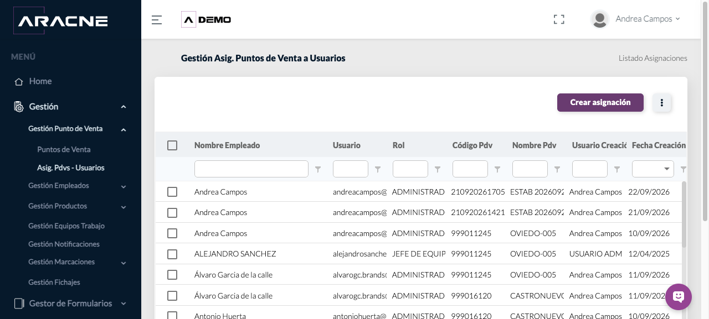
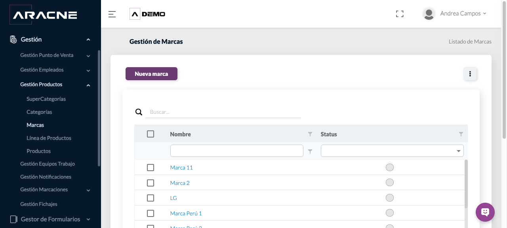
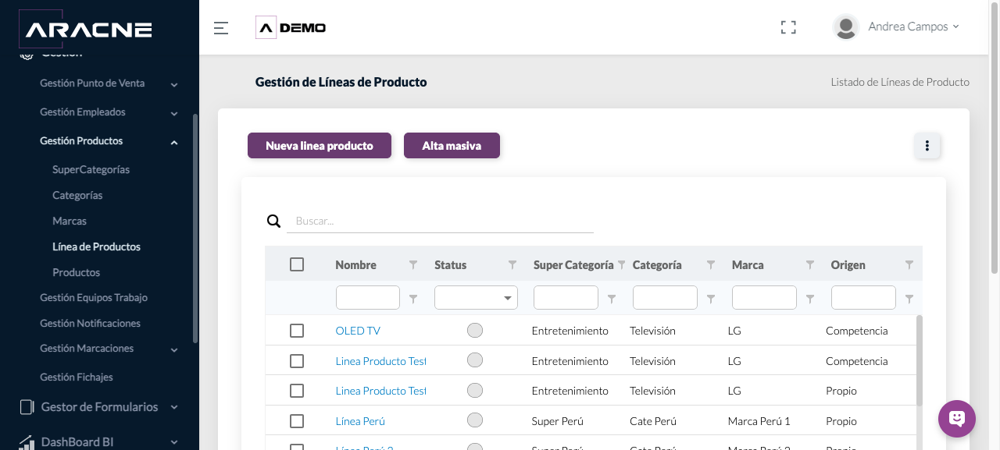
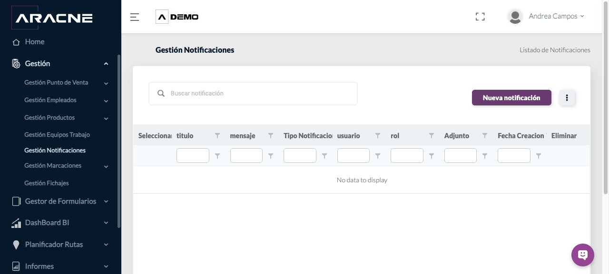
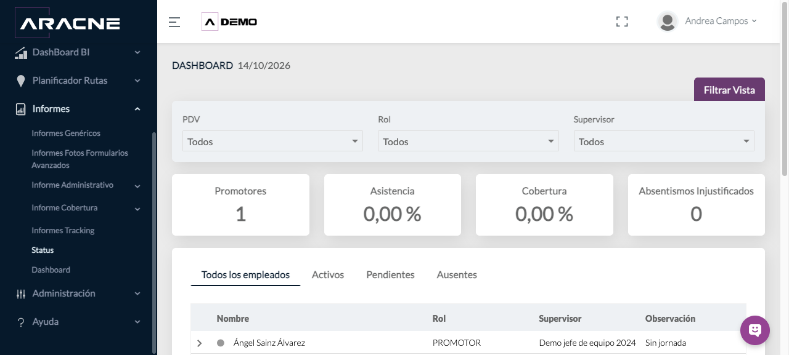
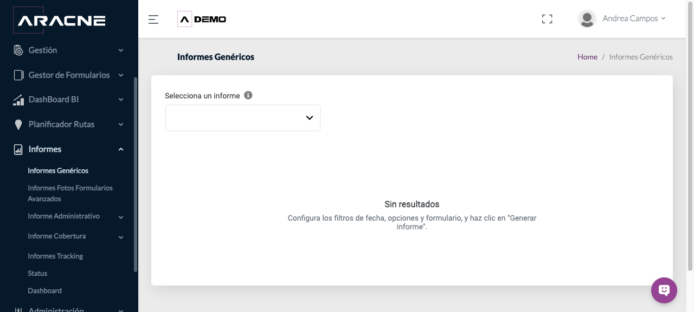
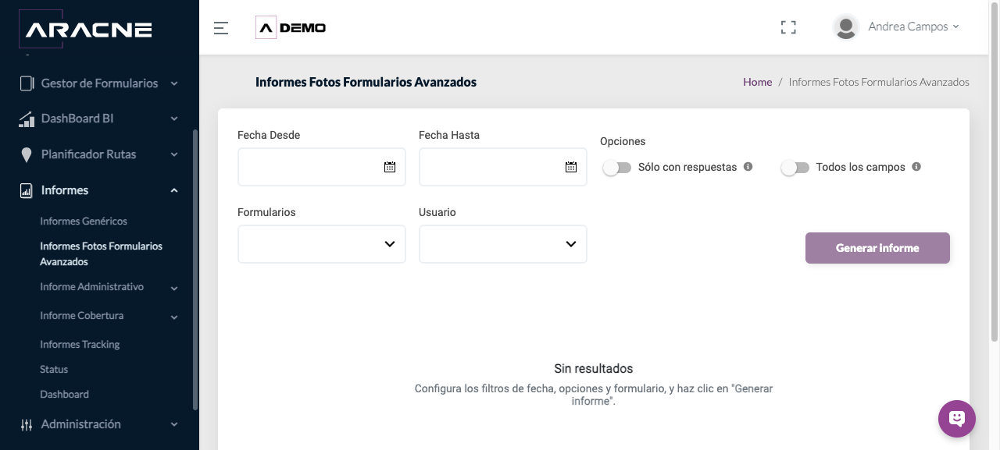
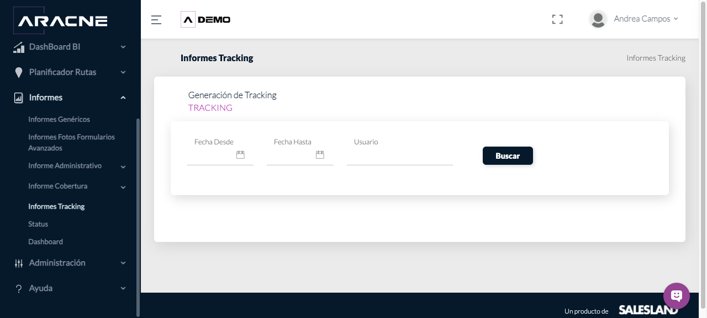
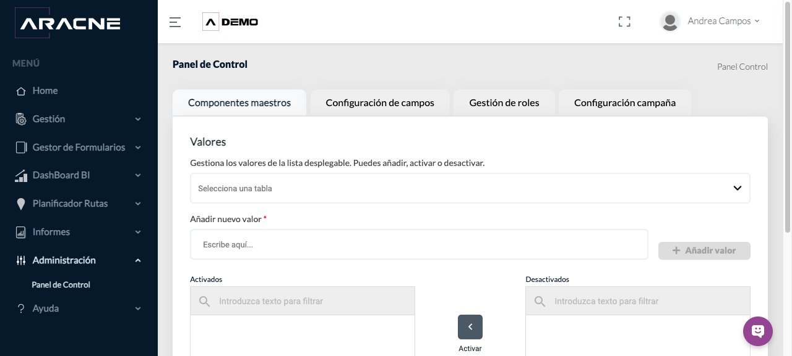

# Manual de usuario de Aracne Shopper

**Campaña de referencia web:** ESPAÑA - DEMO  
**Roles:** Back Office, Administración y Promotor/App móvil

## Índice
1. [Puntos de Venta](#puntos-de-venta)
2. [Asignación PDV–usuarios](#asignacion-pdv-usuarios)
3. [Empleados y ausencias](#empleados)
4. [Catálogo de productos](#catalogo-productos)
5. [Equipos de trabajo](#equipos)
6. [Notificaciones](#notificaciones)
7. [Gestión de Fichajes](#fichajes)
8. [Formularios Avanzados](#formularios-avanzados)
9. [DashBoard BI, Status y Dashboard](#analitica)
10. [Planificador de rutas](#rutas)
11. [Informes operativos](#informes)
12. [Panel de Control](#panel-control)
13. [Promotor y app móvil](#promotor-app)
14. [Vídeos formativos](#videos-formativos)

## 1. Puntos de Venta

Consultar establecimientos y preparar altas unitarias o cargas masivas.

**Requisitos:** Permiso de gestión de establecimientos; catálogos comerciales configurados.  
**Dónde está:** Gestión › Gestión Punto de Venta › Puntos de Venta

### Procedimiento
1. Usa los filtros del listado para localizar un establecimiento.
   
2. Para un alta individual, abre Alta unitaria y completa Identificación y Registro.
   
   
3. Continúa por Ubicación y contacto, Perfil de negocio y Clasificación comercial. Los campos con asterisco son obligatorios.
   
   
   
4. Revisa los datos y continúa hasta completar el alta.
   
5. Para una carga masiva, descarga la plantilla, rellénala y guárdala como CSV delimitado por comas. El archivo no debe superar 4 MB ni contener líneas vacías al final.
   
   
6. Selecciona Subir archivo y, al terminar, vuelve al listado para localizar los establecimientos.
   
   
### Campos y controles
- Nombre del establecimiento y Código establecimiento: identifican el PDV.
- Provincia, Población, Latitud, Longitud y Distancia mínima: sitúan el establecimiento y apoyan controles de proximidad.
- Tipo de negocio, Canal PDV, Cadena y Sector/Industria: describen el perfil comercial.
- Categoría cliente, Estado operativo, Etapa, Estado, Área de influencia y Origen: clasifican el seguimiento.
- La plantilla contiene 47 columnas, desde nombreComercial hasta productoInteresado4. Respeta exactamente las cabeceras.

### Resultado esperado
El establecimiento queda disponible en el listado y puede asignarse a usuarios, rutas y Formularios Avanzados.

**Cómo comprobarlo:** Filtra por código o nombre y comprueba los datos principales. En una carga, revisa también el histórico de cargas disponible en el menú de acciones.

### Problemas habituales
- Si no aparece Continuar, completa los campos marcados con asterisco.
- Si la carga no se admite, confirma formato CSV, tamaño máximo y ausencia de filas vacías al final.
- Si un valor de catálogo no está disponible, revisa los componentes maestros antes de preparar el archivo.

**Operaciones relacionadas:** Asignación PDV–usuarios, Planificador de rutas, Formularios Avanzados

**Vídeos de Puntos de Venta:** [Abrir la sección correspondiente de la videoteca](pages/videos-formativos.html#backoffice).

## 2. Asignación PDV–usuarios

Relacionar empleados con los establecimientos en los que deben trabajar.

**Requisitos:** Empleado y PDV creados y activos.  
**Dónde está:** Gestión › Gestión Punto de Venta › Asig. Pdvs - Usuarios

### Procedimiento
1. Filtra por empleado, usuario, rol, código o nombre del PDV.
   
2. Abre Crear asignación.
   
3. Selecciona el empleado y los establecimientos correspondientes.
   
4. Confirma la asignación.
   
5. Vuelve al listado y filtra por usuario para comprobarla.
   
### Campos y controles
- Empleado/usuario: persona que recibe el establecimiento.
- Rol: función operativa del usuario.
- Código y nombre PDV: establecimiento asignado.
- Alta masiva: prepara varias relaciones cuando el volumen lo requiera.

### Resultado esperado
La relación usuario–PDV aparece en el listado.

**Cómo comprobarlo:** Busca el usuario y confirma que cada PDV previsto tiene una fila.

### Problemas habituales
- Si no encuentras al empleado, comprueba que esté activo.
- Si falta el PDV, revisa que el alta del establecimiento esté completa.

**Operaciones relacionadas:** Empleados, Puntos de Venta, Planificador de rutas

**Vídeos de asignación:** [Abrir la sección correspondiente de la videoteca](pages/videos-formativos.html#backoffice).

## 3. Empleados y ausencias

Consultar empleados, su rol y su disponibilidad.

**Requisitos:** Permiso de gestión de empleados.  
**Dónde está:** Gestión › Gestión Empleados

### Procedimiento
1. En Empleados, filtra por nombre, usuario, estado, rol o superior.
   
2. Usa Alta unitaria o Alta masiva para incorporar perfiles según el procedimiento interno.
   
3. Comprueba zona horaria, idioma, rol y superior antes de asignar trabajo.
   
4. En Ausencias, consulta el tipo y el intervalo de fechas.
   
5. Comprueba si existe sustitución y documentación asociada cuando corresponda.
   
### Campos y controles
- Status: disponibilidad del perfil.
- Rol y Superior: acceso y jerarquía operativa.
- Zona horaria e Idioma: presentación y registro temporal.
- Tipo de ausencia, fechas, sustitución y observaciones: contexto de indisponibilidad.

### Resultado esperado
El perfil puede asignarse a equipos, PDV y rutas; las ausencias quedan visibles en su listado.

**Cómo comprobarlo:** Localiza al empleado y verifica estado, rol, superior y fechas relevantes.

### Problemas habituales
- Si un empleado no aparece en un selector, comprueba su estado y rol.
- Si las fechas no coinciden, revisa zona horaria y periodo seleccionado.

**Operaciones relacionadas:** Equipos de trabajo, Gestión de Fichajes, Asignación PDV–usuarios

**Vídeos de Empleados:** [Abrir la sección correspondiente de la videoteca](pages/videos-formativos.html#backoffice).

## 4. Catálogo de productos

Mantener la jerarquía comercial usada en productos y formularios.

**Requisitos:** Definir antes la jerarquía y los valores propios o de competencia.  
**Dónde está:** Gestión › Gestión Productos

### Procedimiento
1. Crea o consulta primero Supercategorías.
   
2. Dentro de cada supercategoría, crea las Categorías necesarias.
   
3. Mantén las Marcas disponibles.
   
4. Crea Líneas de producto vinculando supercategoría, categoría, marca y origen.
   
5. Crea o consulta Productos y comprueba sus códigos, línea, marca, origen y PVP.
   
### Campos y controles
- Status: disponibilidad del elemento.
- Origen: distingue producto propio o de competencia cuando el selector lo ofrece.
- Código de barras y código interno: identificadores del producto.
- Etiqueta de producto: clasificación adicional visible en el listado.

### Resultado esperado
La jerarquía queda disponible para seleccionar productos de forma coherente.

**Cómo comprobarlo:** Recorre de supercategoría a producto y confirma que las relaciones coinciden.

### Problemas habituales
- Si una opción no aparece, comprueba que el elemento padre esté activo.
- Si una línea queda mal clasificada, revisa supercategoría, categoría, marca y origen.

**Operaciones relacionadas:** Formularios Avanzados, Panel de Control

## 5. Equipos de trabajo

Agrupar comerciales bajo una supervisión.

**Requisitos:** Supervisor y comerciales creados.  
**Dónde está:** Gestión › Gestión Equipos Trabajo

### Procedimiento
1. Filtra o consulta los equipos existentes.
   
2. Abre Nuevo equipo de trabajo.
   
3. Indica nombre y supervisor.
   
4. Añade los comerciales previstos y guarda.
   
5. Comprueba el número de comerciales en el listado.
   
### Campos y controles
- Supervisor: responsable del equipo.
- N.º comerciales: integrantes asociados.
- Status: disponibilidad operativa del equipo.

### Resultado esperado
El equipo aparece con supervisor, estado y número de comerciales.

**Cómo comprobarlo:** Busca el nombre del equipo y contrasta el número de integrantes.

### Problemas habituales
- Si falta un integrante, comprueba que su perfil esté activo.
- Si no aparece el supervisor, revisa su rol.

**Operaciones relacionadas:** Empleados y ausencias, Planificador de rutas

## 6. Notificaciones

Preparar comunicaciones dirigidas a usuarios o roles.

**Requisitos:** Destinatarios con perfiles activos.  
**Dónde está:** Gestión › Gestión Notificaciones

### Procedimiento
1. Abre Nueva notificación.
   
2. Escribe título y mensaje.
   
3. Selecciona tipo de notificación y destinatarios por usuario o rol.
   
4. Adjunta un archivo solo cuando sea necesario.
   
5. Envía y revisa la entrada en el listado.
   
### Campos y controles
- Título y mensaje: contenido visible al destinatario.
- Tipo de notificación: canal o clasificación.
- Usuario y rol: alcance de destinatarios.
- Adjunto: archivo complementario.

### Resultado esperado
La notificación queda registrada y dirigida al alcance seleccionado.

**Cómo comprobarlo:** Comprueba título, destinatario y fecha en el listado.

### Problemas habituales
- Si el destinatario no aparece, verifica que su usuario y rol estén activos.
- Si no hay registros, confirma los filtros aplicados.

**Operaciones relacionadas:** Empleados y ausencias, Equipos de trabajo

## 7. Gestión de Fichajes

Administrar Horarios, Jornadas, Fichajes y Ausencias.

**Requisitos:** Empleados activos y calendario laboral definido.  
**Dónde está:** Gestión › Gestión Fichajes

### Procedimiento
1. En Horarios, crea o consulta las franjas aplicables.
   
2. En Jornadas, revisa la configuración diaria asociada.
   
3. En Fichajes, filtra los registros de entrada y salida del periodo.
   
4. En Ausencias, revisa las incidencias que afectan a la jornada.
   
5. Contrasta horario, jornada, fichajes y ausencias antes de resolver una discrepancia.
   
### Campos y controles
- Horario: marco temporal asignable.
- Jornada: planificación de trabajo.
- Fichaje: registro de entrada o salida.
- Ausencia: periodo no trabajado con su clasificación.
- Activo: indica si la configuración puede utilizarse.

### Resultado esperado
La planificación y los registros de jornada pueden consultarse conjuntamente.

**Cómo comprobarlo:** Selecciona un empleado y un día; compara horario, jornada, fichajes y ausencias.

### Problemas habituales
- Si no hay fichajes, comprueba la jornada y el periodo.
- Si la hora parece desplazada, revisa la zona horaria del empleado.
- Si hay ausencia, comprueba su intervalo antes de interpretar la jornada.

**Operaciones relacionadas:** Empleados y ausencias, Promotor y app móvil

## 8. Formularios Avanzados

Configurar formularios complejos, organizarlos en secciones, definir campos y dependencias, y asignarlos a establecimientos.

**Requisitos:** Roles, establecimientos y catálogos necesarios creados.  
**Dónde está:** Gestor de Formularios › Formularios Avanzados

### Procedimiento
1. Abre Nuevo formulario avanzado. En Configuración indica Nombre, Roles que verán el formulario, dónde se rellena, número de respuestas, obligatoriedad y estado.
   
   
2. Define si se registrarán horas y coordenadas, si habrá alertas y, cuando proceda, los destinatarios.
   
3. Continúa a Estructura y control. Añade secciones con un nombre claro y ordénalas según el trabajo de campo.
   
4. Añade campos dentro de cada sección. Indica Nombre del campo, Tipo de campo y descripción; activa solo las opciones necesarias.
   
5. Configura validación por longitud, rango numérico, escala u opciones cuando el tipo de campo lo permita. Marca Campo obligatorio cuando deba impedirse una respuesta incompleta.
   
6. Crea dependencias seleccionando Origen, Valores del campo de origen, Habilitar y Campo/Sección que habilita.
   
7. Revisa Diseño para confirmar orden, agrupación y comprensión.
   
8. Asigna el formulario a los establecimientos correspondientes desde la opción de asignación del formulario.
   
9. Activa el formulario y comprueba su disponibilidad con un usuario del rol asignado.
   
### Campos y controles
- Roles que verán el formulario: perfiles que reciben el formulario.
- Dónde se rellena: contexto de cumplimentación.
- Número de respuestas por día/establecimiento: frecuencia admitida.
- Campo activo y obligatorio: disponibilidad y exigencia.
- Traer respuestas anteriores: recupera datos previos cuando se configura.
- Origen y valor: condición que dispara la dependencia.
- Habilitar y Campo/Sección que habilita: efecto de la condición.
- Asignación a establecimientos: limita dónde debe aparecer.

### Resultado esperado
El formulario activo aparece para los roles y establecimientos asignados, con secciones, reglas y dependencias previstas.

**Cómo comprobarlo:** Usa un perfil de prueba del rol: abre el establecimiento, entra al formulario, recorre secciones, activa cada dependencia y confirma obligatoriedad y límites.

### Problemas habituales
- Si no aparece, comprueba estado, rol y asignación al establecimiento.
- Si una dependencia no se activa, revisa el campo de origen y el valor exacto.
- Si un campo queda fuera de lugar, revisa su sección y el orden en Diseño.
- Si no permite finalizar, localiza los campos obligatorios sin respuesta.

**Operaciones relacionadas:** Puntos de Venta, Fotos de Formularios Avanzados, Promotor y app móvil

## 9. DashBoard BI, Status y Dashboard

Consultar indicadores operativos y vistas resumidas de actividad.

**Requisitos:** Datos de campaña cargados y permisos de consulta.  
**Dónde está:** DashBoard BI o Informes › Status / Dashboard

### Procedimiento
1. En DashBoard BI, selecciona el reporte disponible.
   
2. En Status, aplica filtros de PDV, rol y supervisor; alterna entre empleados según su estado.
   
3. En Dashboard, filtra por rol, cadena, canal, categoría y regional.
   
4. Revisa asistencia, cobertura, absentismo, usuarios y promotores.
   
5. Expande los gráficos cuando necesites el detalle.
   
### Campos y controles
- Filtros: acotan el universo del indicador.
- Asistencia y cobertura: proporciones del periodo mostrado.
- PDV programados y visitados: recuentos de actividad.
- Ausencias justificadas e injustificadas: incidencias del día.

### Resultado esperado
Los indicadores se actualizan al ámbito elegido.

**Cómo comprobarlo:** Confirma los filtros activos y contrasta los recuentos con el detalle disponible.

### Problemas habituales
- Si un indicador queda a cero, revisa fecha y filtros antes de interpretar el resultado.
- Si un usuario aparece sin jornada, consulta Gestión de Fichajes.

**Operaciones relacionadas:** Gestión de Fichajes, Planificador de rutas, Tracking

## 10. Planificador de rutas

Consultar y preparar rutas programadas y periódicas por usuario.

**Requisitos:** Usuarios activos y PDV asignados.  
**Dónde está:** Planificador Rutas › Rutas

### Procedimiento
1. Localiza al usuario por nombre, usuario o rol.
   
2. Revisa los contadores Número Rutas Programadas y Número Rutas Periódicas.
   
3. Abre el detalle del usuario para consultar la planificación.
   
4. Usa una ruta programada para visitas en fechas concretas.
   
5. Usa una ruta periódica cuando la planificación se repita con una frecuencia definida.
   
6. Después de un cambio, pide al promotor actualizar la planificación en la app.
   
### Campos y controles
- Rutas programadas: planificación asociada a fechas concretas.
- Rutas periódicas: planificación recurrente.
- Alta masiva: preparación de varias rutas mediante el flujo disponible.

### Resultado esperado
El listado refleja los contadores de ambos tipos de ruta y el promotor recibe la planificación al actualizar.

**Cómo comprobarlo:** Comprueba los contadores del usuario y después la agenda de la app.

### Problemas habituales
- Si una visita no llega a la app, comprueba usuario, fecha y actualización de planificación.
- Si el PDV no está disponible, revisa su asignación al usuario.

**Operaciones relacionadas:** Puntos de Venta, Asignación PDV–usuarios, Promotor y app móvil

## 11. Informes operativos

Generar Informes Genéricos, consultar fotos de Formularios Avanzados y revisar Tracking.

**Requisitos:** Periodo, formulario y usuario disponibles para los filtros.  
**Dónde está:** Informes

### Procedimiento
1. En Informes Genéricos, selecciona un informe y configura fecha, opciones y formulario.
   
2. Pulsa Generar informe y revisa el resultado.
   
3. En Fotos de Formularios Avanzados, define Fecha Desde y Fecha Hasta.
   
4. Elige Solo con respuestas o Todos los campos, y filtra por formulario y usuario.
   
5. Genera el informe de fotos.
   
6. En Tracking, selecciona fecha desde, fecha hasta y usuario; pulsa Buscar.
   
### Campos y controles
- Intervalo de fechas: periodo incluido.
- Solo con respuestas/Todos los campos: alcance del informe fotográfico.
- Formulario y usuario: filtros del origen.
- Buscar/Generar informe: ejecuta la consulta.

### Resultado esperado
Se muestra el resultado correspondiente a los filtros.

**Cómo comprobarlo:** Comprueba título, periodo, formulario y usuario antes de usar los datos.

### Problemas habituales
- Si no hay resultados, amplía el periodo y revisa formulario y usuario.
- Si faltan fotos, comprueba que el campo fotográfico tenga respuesta.
- Si Tracking está vacío, valida el usuario y las fechas.

**Operaciones relacionadas:** Formularios Avanzados, Planificador de rutas, Dashboard

## 12. Panel de Control

Administrar componentes maestros, campos, roles y parámetros de campaña.

**Requisitos:** Permiso de Administración y criterio de configuración acordado.  
**Dónde está:** Administración › Panel de Control

### Procedimiento
1. En Componentes maestros, selecciona la lista y administra sus valores activos e inactivos.
   
2. En Configuración de campos, revisa qué campos forman parte de cada entidad y su comportamiento.
   
3. En Gestión de roles, comprueba los permisos asociados a cada rol.
   
4. En Configuración campaña, revisa los parámetros generales de ESPAÑA - DEMO.
   
5. Tras un cambio, comprueba su efecto con un perfil del rol afectado.
   
### Campos y controles
- Añadir nuevo valor: incorpora una opción a la lista seleccionada.
- Activar/Desactivar: controla la disponibilidad de valores.
- Configuración de campos: adapta la información utilizada por la campaña.
- Gestión de roles: controla el acceso funcional.
- Configuración campaña: establece el comportamiento común de la campaña.

### Resultado esperado
La configuración se aplica al ámbito correspondiente sin alterar otros módulos.

**Cómo comprobarlo:** Abre el módulo relacionado y comprueba el valor, campo, permiso o parámetro con un perfil adecuado.

### Problemas habituales
- Si un valor no aparece, comprueba que esté activo.
- Si un usuario no ve una función, revisa su rol y los permisos.
- Si un campo no se muestra, revisa su configuración y el módulo donde se utiliza.

**Operaciones relacionadas:** Catálogo de productos, Formularios Avanzados, Promotor y app móvil

**Vídeos de novedades:** [Abrir la sección correspondiente de la videoteca](pages/videos-formativos.html#novedades).

## 13. Promotor y app móvil

Consultar la ruta, iniciar y cerrar visitas y cumplimentar Formularios Avanzados desde la app.

> **Capturas reales autorizadas.** Las pantallas proceden del Google Site de Aracne Shopper para el rol Promotor y contienen datos ficticios de demostración. La disposición puede variar según la versión de la aplicación y el dispositivo.

### Descarga y acceso
1. Descarga la aplicación desde la tienda de tu dispositivo.
   
2. Abre la app y accede con tu usuario y clave.
   
3. Selecciona la campaña asignada.
   

### Ruta y comienzo de la visita
1. Abre el listado o calendario de rutas y elige el PDV previsto.
   
2. Comprueba el detalle del PDV. En el establecimiento, pulsa **Iniciar visita**.
   
3. Tras el check-in se activan **Tareas**, **Info PDV**, descanso y **Check-out**.
   

### Tareas y Formularios Avanzados
1. Abre primero los formularios marcados como obligatorios.
   
   
2. Cumplimenta los campos y pulsa **Guardar**. Comprueba el estado completado.
   
3. En formularios con muchos productos, abre **Filtros**, selecciona los criterios y pulsa **Aplicar**.
   

### Check-out y confirmación
1. Con las tareas requeridas completas, abre **Check-out**.
   
2. Selecciona el resultado o tipo de visita y adjunta información adicional cuando corresponda.
   
3. Pulsa **Finalizar visita** y confirma. Comprueba el estado **Completado**.
   
   

**Vídeos para Promotor:** [Abrir la videoteca](pages/videos-formativos.html#promotor).
## 14. Vídeos formativos

Los 17 vídeos oficiales están agrupados por audiencia. En la versión HTML pueden reproducirse en la videoteca; aquí se incluyen sus títulos y enlaces completos.

### Promotor

Uso de rutas, visitas y PDV desde la app.

- **¿Cómo hacer check in y check out dentro de un punto de venta?** — [https://youtu.be/N2EWBDteqAM](https://youtu.be/N2EWBDteqAM)
- **¿Dónde puedo ver mis rutas?** — [https://youtu.be/ToE1x9u4Hjg](https://youtu.be/ToE1x9u4Hjg)
- **Añadir más PDV además de los que ya tengo asignados** — [https://youtu.be/7xOsOPMNOtY](https://youtu.be/7xOsOPMNOtY)

### Back Office / Administrador / Jefe de equipo

Altas, exportación, activación, asignaciones y empleados. La audiencia Jefe de equipo se limita a esta videoteca.

- **Gestión punto de venta: Alta unitaria de un punto de venta** — [https://youtu.be/hx7qCl07OUg](https://youtu.be/hx7qCl07OUg)
- **Gestión punto de venta: Alta masiva de puntos de venta** — [https://youtu.be/FBJBgNIqxMs](https://youtu.be/FBJBgNIqxMs)
- **Gestión punto de venta: Exportar puntos de venta** — [https://youtu.be/DDPKrgVkCmY](https://youtu.be/DDPKrgVkCmY)
- **Gestión punto de venta: Habilitar y deshabilitar uno o más puntos de venta** — [https://youtu.be/zywl09G0rs4](https://youtu.be/zywl09G0rs4)
- **Gestión punto de venta: Ver Histórico de carga de puntos de venta** — [https://youtu.be/AUYiP94644I](https://youtu.be/AUYiP94644I)
- **Gestión punto de venta: Asignar puntos de venta a usuarios (asignación unitaria)** — [https://youtu.be/FC9hXTNQjEg](https://youtu.be/FC9hXTNQjEg)
- **Gestión punto de venta: Asignar puntos de venta a usuarios (asignación masiva)** — [https://youtu.be/8DwlrYD87OI](https://youtu.be/8DwlrYD87OI)
- **Gestión Empleados: alta unitaria de usuarios** — [https://youtu.be/rUwrRbs9qak](https://youtu.be/rUwrRbs9qak)
- **Gestión Empleados: alta masiva de usuarios** — [https://youtu.be/mN8Q80Co1Mo](https://youtu.be/mN8Q80Co1Mo)

### Vídeos de nuevas versiones

Cambios de versión y configuración de campos aplicables a varios roles.

- **Versión 4.0 - Nuevas mejoras** — [https://youtu.be/4_UueZ4SZn4](https://youtu.be/4_UueZ4SZn4)
- **Versión 4.1 - Sistema de configuración de campos (WEB)** — [https://youtu.be/FXNDhZe730w](https://youtu.be/FXNDhZe730w)
- **Versión 4.1 - Sistema de configuración de campos (APP)** — [https://youtu.be/X53aEGksAX4](https://youtu.be/X53aEGksAX4)
- **Versión 4.2.1 - Acceso directo según asignación de campañas** — [https://youtu.be/cfbNpjgKGz4](https://youtu.be/cfbNpjgKGz4)
- **Versión 4.3** — [https://youtu.be/3aUODu3kJPM](https://youtu.be/3aUODu3kJPM)

